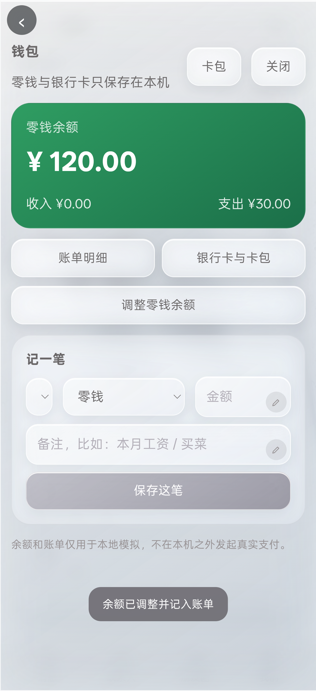
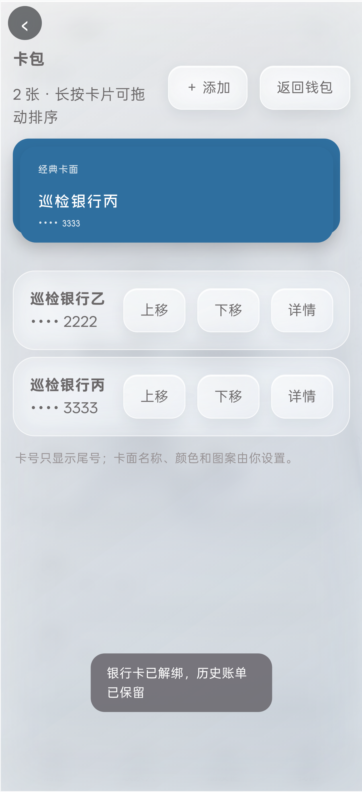
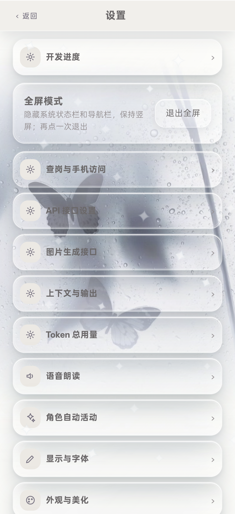

# BS 小手机 3.87 / Build 98｜微信“我的”完整模块、卡包解绑返修与全链路发布报告

- 报告日期：2026-11-07
- 当前版本：3.87 / Build 98
- Service Worker：`bsphone-v98-20261107-r1`
- 业务源码提交：`8f8a249f83494815311d8eb2cda34e6e6862bec2`
- 业务仓库：`C:\Users\lenovo\Documents\ChatGPT\各种的\_ghpages`
- 真机：OPPO PMK110 / Android 16 / 1272×2772
- 最终判定：**本轮微信“我的”模块、钱包/卡包返修、图片与隐藏内容、ZIP + assets、GitHub Pages 发布范围 PASS；其它未审计 App 不自动签收**

## 0. 结论摘要

本轮按“一个 APP / 一个完整功能模块”交付，没有把卡包解绑、余额调整、排序、账单保留拆成多个点单独交卷。

| 范围 | 结果 |
|---|---|
| 微信“我的”全屏模块 | PASS |
| 用户人设库与引用阻止删除 | PASS |
| 钱包账单与余额调整 | PASS |
| 银行卡卡包、多卡、排序、详情、账单 | PASS |
| 银行卡解绑与历史账单保留 | PASS |
| 微信资产、表情包、收藏 | PASS |
| 图片重 roll、图片分支、隐藏内容恢复 | PASS |
| ZIP + assets 与校验 | PASS |
| GitHub Pages 线上发布 | PASS |
| 核心断言 | 25/25 PASS |
| 全量回归 | 7/7 PASS |
| 真机 Debug/CDP | 11/11 PASS |
| 独立审计 | 5/5 PASS |
| Release smoke | 9/9 PASS |

## 1. 当前模块任务详情

### 1.1 微信“我的”完整模块

用户路径：

1. 微信 → 我的；
2. 点击用户人设库、钱包、卡包、资产、表情包、收藏；
3. 每个入口均进入独立全屏页面；
4. 返回链路保持正确，不跳桌面、不丢当前上下文。

已实现：

- 当前启用的人设名称、头像同步到“我的”；
- 用户人设库全屏列表、新建、编辑、上传头像；
- 姓名、年龄、性别、身份、外貌、性格、关系、背景、说话风格、补充设定；
- 多选世界书绑定；
- 启用/取消启用人设；
- 切换启用人设只影响新会话和非聊天场景；
- 删除人设前检查会话、情侣空间、外卖地址、小说引用；
- 被引用时阻止删除并列出引用。

### 1.2 钱包

已实现：

- 全屏钱包；
- 零钱余额；
- 收入/支出统计；
- 账单明细；
- 记一笔收入/支出；
- 可选零钱或银行卡；
- 调整零钱余额；
- 调整动作生成独立 `adjustment` 账单；
- `adjustment` 不计入收入/支出统计；
- 银行卡账单不改变零钱余额；
- 不出现“测试余额”“虚拟银行卡”“虚拟余额”等禁用字样；
- 不连接真实支付接口。

### 1.3 银行卡与卡包

已实现：

- 全屏卡包；
- 多卡叠放与卡片列表；
- 卡片名称、尾号、颜色、图案随用户设置；
- 卡号按 4 位分组输入；
- 卡面与列表只显示尾号；
- 添加、编辑；
- 上移、下移；
- 长按拖动排序；
- 鼠标和触屏统一使用 Pointer Capture；
- 卡详情；
- 当前卡账单；
- 二次确认解绑；
- 解绑只移除卡面，不删除历史账单；
- 历史账单保留原银行名、尾号和“已解绑”标记；
- 若外卖支付正在引用该卡，安全降级为小手机钱包；
- 其它银行卡与其它账单不受影响。

### 1.4 微信资产

- 全屏资产页；
- 房产、车辆、店铺、公司、其它；
- 状态、估值、备注；
- 新增、编辑、删除；
- 合计估值；
- 按当前启用用户人设持久化。

### 1.5 表情包

- 全屏分组管理；
- 新建分组；
- 重命名分组；
- 删除分组；
- 删除分组时表情移动到默认分组，不删除表情；
- 添加、删除、备注、移动、排序；
- 默认分组不可删；
- 聊天输入栏保留真实微信表情面板，不混入 AI 生图入口。

### 1.6 收藏

- 全屏页面；
- 全部、消息、图片、链接、订单、位置、小说分类；
- 搜索；
- 取消收藏；
- 回到原会话；
- 原消息删除后仍保留收藏快照；
- 收藏页显示“原消息已删除”，正式聊天 UI 不显示该标记。

### 1.7 继承并保持的微信能力

本轮没有回滚上一轮已完成的：

- 图片消息重 roll；
- 图片提示词编辑、AI 编写、本次参考图；
- 图片分支恢复、导出、删除；
- 删除显示与已隐藏内容恢复；
- 隐藏项不进入 Prompt；
- 图片分支与文字分支同步；
- ZIP + assets 构建、导入、校验；
- 连续消息组整组重 roll；
- 编辑并重新生成；
- 手动分支与继续；
- 记忆与分支作用域隔离；
- 群聊角色级“忘记这条”；
- 备注名摘要清理。

## 2. 任务进程

| 阶段 | 动作 | 结果 |
|---|---|---|
| 1. 接手 | 读取 3.86 / Build97 报告、STATE、DECISIONS 与微信 PRD 11.1～11.6 | 确认下一完整 App 模块是微信“我的” |
| 2. 语义对齐 | 区分零钱、银行卡账单、余额调整、解绑、永久删除 | 不把解绑做成删除历史 |
| 3. 模块构建 | 用户人设库、钱包、卡包、资产、表情、收藏统一全屏 | PASS |
| 4. 返修缺口 | 补回旧钱包余额调整、补回银行卡解绑 | PASS |
| 5. 多卡与排序 | 三张卡、上移下移、长按拖动、卡账单 | PASS |
| 6. 解绑语义 | 二次确认、账单快照保留、支付方式降级 | PASS |
| 7. 数据接入 | 钱包通过 `coreStore().commands.upsertPersona` 提交 | PASS |
| 8. 旧能力保护 | 图片分支、隐藏 Prompt、ZIP assets 校验独立复测 | PASS |
| 9. 构建 | 重建 Debug/Release APK 与 Release ZIP | PASS |
| 10. 真机 | Debug 11/11、微信模块 15/15、Release smoke 9/9 | PASS |
| 11. 发布 | Pages 构建、version/cacheKey/APK 哈希核验 | PASS |
| 12. 交卷 | 生成证据清单与完整报告 | PASS |

## 3. 语义对齐颗粒度

| 语义 | 本轮实现 |
|---|---|
| 零钱余额 | 只代表零钱，不等同银行卡额度 |
| 银行卡账单 | 归属具体卡，不改变零钱余额 |
| 余额调整 | 独立 `adjustment` 记录，不计入收入/支出 |
| 解绑银行卡 | 只移除卡面；不删除卡账单、不删除订单、不删除收藏 |
| 已解绑卡账单 | 保留银行名、尾号、金额、备注、时间，并显示“已解绑” |
| 永久删除银行卡数据 | 本轮没有提供；解绑不是永久删除 |
| 卡号隐私 | 输入按 4 位分组，列表和卡面只显示尾号 |
| 长按拖动 | 到达 520ms 后进入拖动，使用 Pointer Capture，触屏/鼠标同路径 |
| 启用人设 | 影响新会话和非聊天场景身份，不改已有会话绑定 |
| 删除人设 | 被会话、情侣空间、外卖地址、小说引用时阻止 |
| 全屏模块 | 人设、钱包、卡包、资产、表情、收藏均为全屏页 |
| 删除显示 | 隐藏消息而非永久删除 |
| 已隐藏内容 | 不进入 Prompt，可在原位置恢复 |
| 图片分支 | 文字分支和图片版本双向同步，不回退到旧图 |
| ZIP assets | snapshot 与 assets 都校验 checksum |
| UI 禁用词 | 钱包与卡包不出现“测试余额”“虚拟银行卡”“虚拟余额” |
| Store 隔离 | 钱包更新走 `coreStore().commands.upsertPersona`，不直接重写 Global Store/DB 数据流 |

## 4. 逻辑证据

桌面微信“我的”模块证据：

- `docs/testing/round122-wechat-mine-suite.json`
- `ok: true`
- 17 项检查全部 PASS
- 覆盖：我的页入口、全屏人设、新建人设、钱包、余额调整、卡包、三卡、分组排序、卡账单、卡详情、解绑、解绑后账单、资产、表情、收藏、引用阻止删除、无运行时错误

关键数据：

- 三张卡：`•••• 1111`、`•••• 2222`、`•••• 3333`
- 长按拖动排序前后顺序变化正确
- 卡账单：`18.00` 支出，零钱余额保持 `150.00`
- 调整余额：`150.00`，`adjustment` 记录写入
- 收入统计仍为 `25.00`，支出统计仍为 `18.00`
- 解绑后银行卡数：`3 → 2`
- 账单数保持 `3`
- 卡账单 `cardUnbound: true`
- 外卖支付：`card → wallet`
- 解绑后账单显示：`巡检银行甲 · 尾号1111 · 已解绑`

独立审计证据：

- `docs/testing/independent-card-unbind-wallet-adjust-2026-11-07.json`
- 9/9 PASS
- 其他银行卡保留
- 历史账单不丢失
- 收入/支出统计不被调整记录污染
- 无完整卡号泄露
- `walletCommit` 使用 Store command

### 4.1 按钮尺寸证据

| 页面 | 按钮/尺寸 |
|---|---|
| 钱包 | 卡包、关闭、账单、银行卡与卡包、调整余额、保存这笔均 ≥44px |
| 卡包 | 添加、返回钱包、上移、下移、详情均 ≥44px |
| 卡详情 | 返回、查看账单、编辑卡面、解绑银行卡均 ≥44px |

## 5. 真机巡检

设备：

- 型号：OPPO PMK110
- Android：16
- 分辨率：1272×2772
- 序列号：`3B665K02PNH00000`

真机流程：

1. `adb install -r` 安装最终 Debug；
2. 通过 WebView CDP 执行 11 个真机脚本；
3. 真机微信“我的”模块执行 15 项检查；
4. 使用真实触摸事件完成三卡长按拖动；
5. 覆盖安装回 Release；
6. 拉回设备内 APK 并比对 SHA-256；
7. 冷启动、WebView 根节点、logcat、数据保留检查。

真机结果：

- 真机 Debug/CDP：11/11 PASS
- 微信模块：15/15 PASS
- 三卡触摸拖动：PASS
- 解绑后账单保留：PASS
- 外卖支付降级：PASS
- Release smoke：9/9 PASS
- 未执行 `pm clear`
- `firstInstallTime=2026-10-20 23:07:55`
- `ceDataInode=2120975`
- 设备内 APK SHA-256 与 Release 候选一致
- 无 FATAL EXCEPTION / ANR

真机证据：

- `docs/testing/round122-phone-wechat-mine-suite.json`
- `docs/testing/round122-phone-debug-suite-final-2026-11-07.log`
- `docs/testing/round122-phone-release-final-2026-11-07.json`
- `docs/testing/round122-phone-release-final-logcat-2026-11-07.txt`
- `docs/testing/round122-release-final-home.png`
- `docs/testing/round122-release-final-window.xml`

## 6. 截图证据








截图对应文件：

- `docs/testing/round122-phone-wechat-mine.png`
- `docs/testing/round122-phone-persona.png`
- `docs/testing/round122-phone-cards.png`
- `docs/testing/round122-release-final-home.png`

## 7. 全量回归测试报告

### 7.1 核心断言

日志：`docs/testing/round122-final-core-2026-11-07.log`

- 25/25 PASS
- 包含：消息编辑、连续组重 roll、分支切换、Prompt 分层、记忆隔离、忘记作用域、图片分支、隐藏内容、ZIP、微信“我的”、卡包解绑

### 7.2 全量页面回归

日志：`docs/testing/round122-final-regression-suite-2026-11-07.log`

- 亮色：33 桌面 + 33 窄屏 PASS
- 暗色：33 桌面 + 33 窄屏 PASS
- R108：PASS
- R109：PASS，cacheKey 为 `bsphone-v98-20261107-r1`
- 数据管理：17/17 PASS
- 分组语义：14/14 PASS
- 批次 3 红队修复：13/13 PASS
- 汇总：7/7 PASS

### 7.3 独立审计

日志：`docs/testing/round122-independent-audits-2026-11-07.log`

- 隐藏图片不进入 Prompt：PASS
- 图片恢复与文字分支同步：PASS
- ZIP assets checksum 篡改拒绝：PASS
- 银行卡解绑与余额调整：PASS
- Release ZIP 包完整性：17 entries / 15 checksums PASS
- 汇总：5/5 PASS

### 7.4 真机回归

日志：`docs/testing/round122-phone-debug-suite-final-2026-11-07.log`

- R117：PASS
- R114：PASS
- 分支 UI：PASS
- R101：PASS
- R112：PASS
- R113：PASS
- R119：PASS
- R120：PASS
- R118：PASS
- R121：PASS
- R122 微信“我的”：PASS
- 汇总：11/11 PASS

## 8. 版本、构建与发布

### 8.1 本地构建

- 页面：`2026-11-07 · 3.87 · 第 98 轮`
- Android：3.87 / versionCode 98
- Service Worker：`bsphone-v98-20261107-r1`
- 源码 SHA-256：`D3F4E538CC226F6361FC0B5DA50D29EF3A8FF36EC067A79D425F2F22DE2CCFB4`
- Debug APK SHA-256：`E88115A380025A404F529B5B291F9FA113CF96BE065FDBDE55D5A30288B0D21E`
- Release APK SHA-256：`9434AAD1E1ABE37EE127B4250A39B51F3DA3EA7CDFC9529FF508731563B9C513`
- Release ZIP SHA-256：`F7AF762E2F7AB2CDA68174E7669319A94D4CF8F09C1C4256380F3176ECFF3D94`

Release 候选目录：

`C:\Users\lenovo\Documents\ChatGPT\各种的\_release_candidate_2026-11-07_Build98`

构建日志：

- `docs/testing/build98-native-build-2026-11-07.log`
- `BUILD SUCCESSFUL`
- 66 actionable tasks

### 8.2 Release ZIP 内容

独立审计：`docs/testing/round122-release-package-audit-2026-11-07.json`

- ZIP entries：17
- checksums checked：15
- manifest：PASS
- checksums：PASS
- assets/public：PASS
- APK included：PASS
- APK 与 manifest 哈希一致：PASS
- 发布 APK 与 root `BS小手机.apk` 一致：PASS
- 版本与 cacheKey：PASS

### 8.3 GitHub Pages

- 页面：`https://blkst123.github.io/bsphone/`
- Pages build：`1348685543`
- 状态：`built`
- 构建提交：`8f8a249f83494815311d8eb2cda34e6e6862bec2`
- 线上版本：3.87 / 98
- 线上 cacheKey：`bsphone-v98-20261107-r1`
- 线上 APK SHA-256：`9434AAD1E1ABE37EE127B4250A39B51F3DA3EA7CDFC9529FF508731563B9C513`
- 本地 Release 与线上 APK：一致
- 线上 index 规范化前字节哈希：`9E604C05B350B547843554E322AEC119CF80F1AD0B521585E5C2559BFC449EFA`
- 本地/线上 index 规范化后 SHA-256 均为：`92515556796919CC8A346DA9DAA2E55FF3DD3A369FB688F402A29C1CC3AA1F0D`
- 差异原因：GitHub Pages 对换行进行规范化，内容一致

线上证据：

- `docs/testing/round122-online-publish-2026-11-07.json`

## 9. 证据总清单

`docs/testing/round122-evidence-manifest-2026-11-07.json`

- `ok: true`
- 测试 JSON：49 个
- 日志：6 个
- 截图：11 张
- 源码提交：`8f8a249f83494815311d8eb2cda34e6e6862bec2`
- 源码 SHA-256：`D3F4E538CC226F6361FC0B5DA50D29EF3A8FF36EC067A79D425F2F22DE2CCFB4`
- Debug APK SHA-256：`E88115A380025A404F529B5B291F9FA113CF96BE065FDBDE55D5A30288B0D21E`
- Release APK SHA-256：`9434AAD1E1ABE37EE127B4250A39B51F3DA3EA7CDFC9529FF508731563B9C513`
- Release ZIP SHA-256：`F7AF762E2F7AB2CDA68174E7669319A94D4CF8F09C1C4256380F3176ECFF3D94`
- cacheKey：`bsphone-v98-20261107-r1`
- 缺失项：0
- 失败项：0

## 10. 未完成边界

本轮不声称以下内容完成：

- 其它尚未经过本轮完整模块审计的 App；
- 银行卡与真实支付机构、银行接口、真实卡号验证的接入；
- 银行卡永久删除历史账单的能力；
- 其它未在本报告中列出的旧审计遗留项；
- 任何未经真机巡检和历史功能回归的后续改动。

## 11. 最终签署

```text
微信“我的”完整模块：PASS
用户人设库与引用阻止删除：PASS
钱包账单与余额调整：PASS
银行卡卡包与多卡排序：PASS
长按拖动（鼠标 + 真机触摸）：PASS
银行卡解绑与历史账单保留：PASS
外卖支付安全降级：PASS
资产 / 表情包 / 收藏：PASS
图片重 roll / 图片分支：PASS
隐藏内容恢复与 Prompt 排除：PASS
ZIP + assets / checksum：PASS
核心断言 25/25：PASS
全量回归 7/7：PASS
独立审计 5/5：PASS
真机 Debug/CDP 11/11：PASS
真机微信模块 15/15：PASS
Release smoke 9/9：PASS
GitHub Pages 3.87 / Build98：PASS
```

**本轮最终判定：PASS（本报告列明的微信“我的”及关联发布范围）。**
