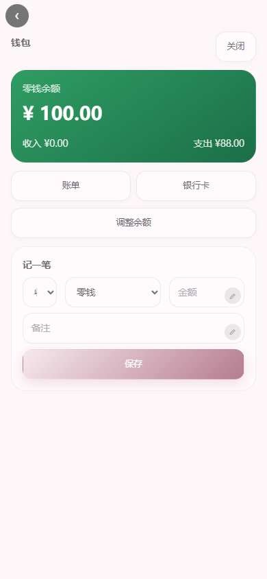
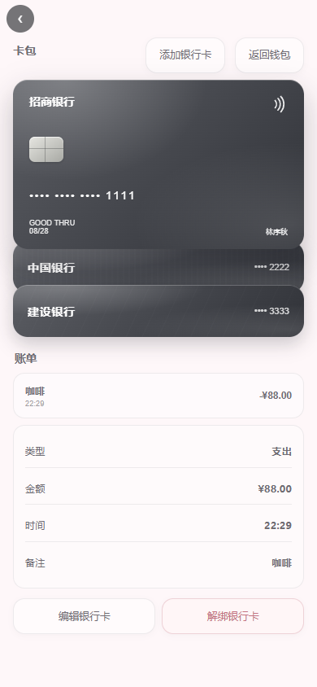
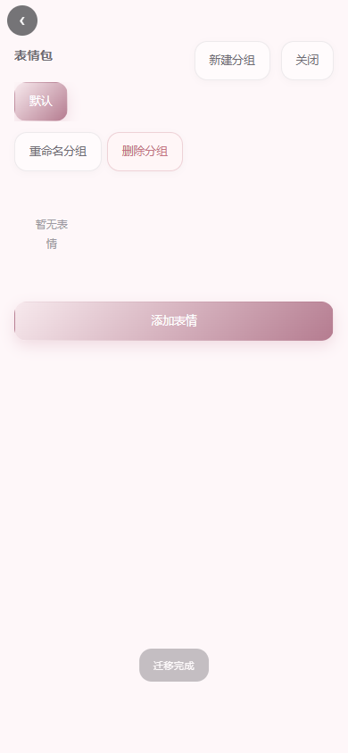
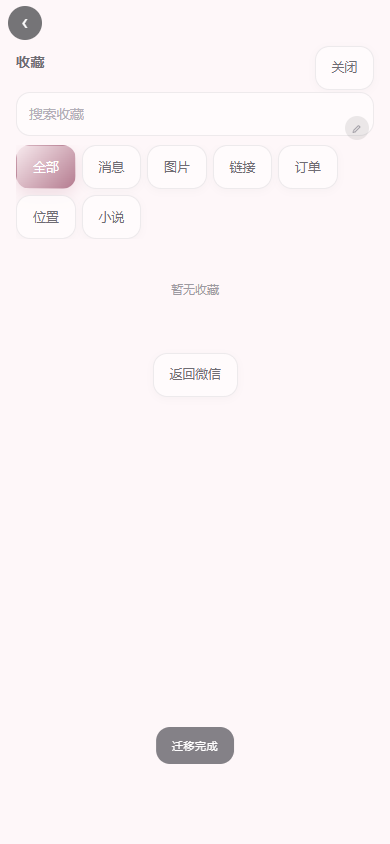
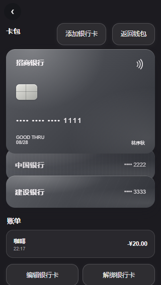

# BS 小手机 3.88 / Build 99｜微信“我的”UI 返修与卡包交互重建｜完整报告

- 报告日期：2026-11-07
- 版本：3.88 / Build 99
- Service Worker：`bsphone-v99-20261107-r1`
- 业务源码提交：`af61775fa2d58052a47d8ca5c00b6d286c591b52`
- 源码 SHA-256：`983560673A19449CF88226DDB837E97EE919694505E15255DD1489FFE011874B`
- 真机：OPPO PMK110 / Android 16 / 1272×2772
- 最终判定：**本轮微信“我的”与卡包返修范围 PASS；其它未完整审计 App 不自动签收**

## 0. 结论摘要

本轮按检查官与红队的两份 3.87 / Build98 报告逐项返修，并同时完成用户指出的 UI 与交互问题：

- 删除 PRD 未要求的解释小字、标题副标题、模块底部说明和“点击按钮即可”式文案；
- 空状态收敛为一句话，操作由页面主按钮或唯一动作按钮完成；
- 卡包不再使用“上移/下移”行按钮；
- 卡面按参考图重绘为石墨/银灰系真实银行卡结构；
- 卡片本身叠放，点击卡片切换选中并在当前卡片下内联展开账单；
- 点击账单行继续内联展开详情，没有新增“账单详情”按钮，也不跳账单详情页；
- 长按拖动改为真实连续触摸路径，不再依赖单次瞬移测试。

## 1. 当前模块任务详情

### 1.1 微信“我的”

- 全屏入口：用户人设库、钱包、卡包、资产、表情包、收藏；
- 当前启用的人设名称和头像同步“我的”；
- “编辑资料”直接更新当前启用人设；
- 不再显示“已启用：xxx”“接口、语音、备份”“壁纸、深色”等标题副标题；
- 不添加 PRD 未要求的解释性小字。

### 1.2 钱包

- 全屏钱包；
- 顶部余额卡；
- 收入、支出；
- 账单入口；
- 银行卡入口；
- 调整余额；
- 记一笔；
- 不显示隐私、模拟、说明性 footer；
- 金额统一有限值校验；
- 银行卡账单不改变零钱余额；
- 余额调整写入独立 `adjustment`，不污染收入/支出统计。

### 1.3 卡包

卡面：

- 石墨、银灰、深墨、暖灰四种中性卡面；
- 芯片、闪付、分组卡号、尾号、有效期、持卡人；
- 不显示真实品牌 Logo；
- 列表和页面只显示尾号；
- 添加页保留 PRD 指定的隐私提示。

交互：

- 卡片叠放展示；
- 点击非当前卡：切换选中并展开该卡账单；
- 点击当前卡：展开/收起账单；
- 点击账单行：在原位置内联展开详情；
- 不提供“账单详情”跳转按钮；
- 不提供上移/下移按钮；
- 长按 500ms 进入拖动；
- 连续拖动只在松手时提交一次顺序；
- 拖动后不误触详情；
- 关闭再进入后顺序保留；
- 解绑二次确认，历史账单保留，卡支付降级为零钱。

### 1.4 资产

- 全屏资产页；
- 同尺寸资产卡；
- 房产、车辆、店铺、公司、其它；
- 名称、状态、估值、备注；
- 角色多选、世界线关联并持久化；
- 非有限估值拒绝写入；
- 原有非法值读取和导出时归零；
- 删除二次确认。

### 1.5 表情包

- 全屏分组管理；
- 新建、重命名、删除分组；
- 删除分组时表情移入默认分组；
- 添加、删除、备注、移动、排序；
- 删除分组和表情均二次确认；
- 不显示“一行四个”“点右上角”等解释文案。

### 1.6 收藏

- 全屏；
- 全部、消息、图片、链接、订单、位置、小说分类；
- 搜索；
- 取消收藏；
- 回到原会话；
- 原消息删除后保留快照并标注“原消息已删除”；
- 空状态只显示“暂无收藏”及唯一动作按钮。

## 2. 任务进程

| 阶段 | 动作 | 结果 |
|---|---|---|
| 1. 接单 | 读取两份 Build98 打回报告、微信 PRD、22/24 UI 规范、20 页面地图、银行卡参考图 | 确认 UI 返修与 5 个 P1、3 个 P2 同时处理 |
| 2. 文案清理 | 删除所有未在 PRD 出现的解释小字、标题副标题和模块说明 | PASS |
| 3. 卡面重建 | 按参考图绘制中性卡面、芯片、闪付、卡号、有效期、持卡人 | PASS |
| 4. 卡包交互 | 叠放切换、点击内联账单、账单行内联详情、取消上下移按钮 | PASS |
| 5. 拖动返修 | `touch-action:none`、Pointer Capture、稳定拖拽会话、单次提交 | PASS |
| 6. 人设引用 | 统一引用索引，补齐情侣空间、外卖地址、支付、订单、购物车、小说等 | PASS |
| 7. 人设迁移 | 迁移目标、预览、确认迁移并删除、失败回滚 | PASS |
| 8. 金额边界 | 钱包/资产有限值校验、读取清洗、导出清洗 | PASS |
| 9. 手动资料 | “编辑资料”直接更新当前启用人设 | PASS |
| 10. 资产关联 | 角色多选和世界线关联持久化 | PASS |
| 11. 构建 | Debug/Release Build99 与 Release ZIP | PASS |
| 12. 真机 | 11 个真机脚本、连续 10 段触摸拖动、Release smoke | PASS |
| 13. 发布 | GitHub Pages 3.88 / Build99 校验 | PASS |
| 14. 交卷 | 完整报告与证据总清单 | PASS |

## 3. 语义对齐颗粒度

| 语义 | 本轮理解与实现 |
|---|---|
| 删除显示 | 不是永久删除；隐藏项不进 Prompt，可原位恢复 |
| 银行卡点击 | 点击卡片只在本页展开该卡账单，不跳新页面 |
| 账单详情 | 点击账单行原位展开，不新增“账单详情”按钮 |
| 卡片排序 | 长按卡片后上下拖动；没有上移/下移按钮 |
| 卡包切换 | 点击叠放卡片切换当前卡，不改变其它卡业务数据 |
| 卡号隐私 | 页面与卡面只显示尾号，完整卡号只在编辑输入框内 |
| 卡面颜色 | 只使用石墨/银灰中性色，不使用脱离主题的蓝紫棕绿 |
| 卡账单 | 银行卡账单不修改零钱余额 |
| 余额调整 | 写 adjustment 账单，不计入收入/支出统计 |
| 解绑银行卡 | 只移除卡面，历史账单保留并标记“已解绑” |
| 卡支付降级 | 被解绑卡若用于外卖支付，自动降级为零钱 |
| 人设启停 | 只影响新会话和非聊天场景，不改已有会话绑定 |
| 删除人设 | 被引用时必须先迁移；迁移预览后才可删除 |
| 手动编辑资料 | 直接修改当前启用人设，不产生保存后无效的覆盖层 |
| 资产关联 | 角色为多选，世界线为单选，随资产持久化 |
| Prompt 隐藏项 | 隐藏图片/消息不进入实际 Prompt |
| 图片分支 | 文字分支和图片版本双向同步 |
| ZIP assets | snapshot 和 assets 都校验 checksum |
| 空状态 | 一句文本加唯一明确操作 |
| 小字 | 只保留 PRD 明确要求的隐私提示和必要的账单元数据 |
## 4. P1/P2 返修闭环

| 编号 | 问题 | 修复 | 证据 |
|---|---|---|---|
| P1-01 | 真机连续触摸拖动被 pointercancel | `touch-action:none`；拖拽会话稳定；拖动不重绘；松手单次提交 | `round123-card-touch-interactions.json` |
| P1-02 | 人设引用漏情侣空间/外卖地址/支付/订单 | 统一 `personaReferenceIndex`，覆盖完整引用 | `round123-wechat-mine-ui-qa.json` |
| P1-03 | 1e309 变 Infinity | `Number.isFinite` + 上限；读取/导出清洗；大 JSON 分块写入 | `round123-financial-export-audit.json`、`round101-phone-export.json` |
| P1-04 | 手动编辑资料保存无效 | 编辑当前启用人设并同步 DB.me | `round123-wechat-mine-ui-qa.json` |
| P1-05 | 资产无角色/世界线关联 | `characterIds` + `worldlineId` 编辑器与持久化 | `round123-wechat-mine-ui-qa.json` |
| P2-01 | 卡包无逐张切换、视觉首卡错误 | 叠放卡面、点击切换、首卡与顺序一致 | `round123-wechat-mine-ui-qa.json` |
| P2-02 | 人设删除无迁移流程 | 目标选择、引用预览、确认迁移删除、失败回滚 | `round123-wechat-mine-ui-qa.json` |
| P2-03 | 证据 schema 不统一 | 证据清单标注 `checks/tests/domain-objects`，不再显示误导性 0 覆盖 | `round123-evidence-manifest-2026-11-07.json` |

## 5. UI 证据

### 5.1 文案清理

以下文案已从“我的”模块删除：

- “这里是「你」的资料……”
- “零钱与银行卡只保存在本机”
- “合计估值……跟随当前人设”
- “长按卡片可拖动排序”
- “卡号只显示尾号……”
- “本地模拟资产卡”
- “一行四个……”
- “点右上角……”
- “点击按钮即可……”
- 各页标题下的复述型副标题

保留的说明只有 PRD 明确要求的银行卡隐私提示、删除/解绑二次确认和用户自己填写的备注。

### 5.2 截图














## 6. 逻辑与交互证据

### 6.1 卡片拖动

`round123-card-touch-interactions.json`：

- 第三张拖到第一张：`["c","a","b"]`
- 第一张拖到最后：`["b","c","a"]`
- 相邻拖动：`["a","c","b"]`
- 取消拖动：恢复 `["a","b","c"]`
- 每次连续 10 次 `touchMove`
- 拖动过程中没有进入账单详情
- 鼠标拖动：`["c","a","b"]`
- `touch-action: none`
- 正常点击仍可切换并展开账单

### 6.2 卡片账单

- 点击卡片本身即展开当前卡的账单详情区域，不新增入口、不切换路由、不进入独立账单详情页；
- 点击卡片后出现 `.card-bills-panel`
- 没有“账单详情”按钮
- 点击账单行出现 `.card-bill-detail`
- route 保持 `wechat`
- 不跳转新页面

### 6.3 人设引用与迁移

- 引用覆盖：会话、情侣空间、当前绑定、小说、外卖地址簿、外卖支付、外卖订单、外卖绑定
- 迁移后旧人设删除
- 会话、地址 key、支付 key、订单、情侣空间、小说全部迁移到目标人设
- 旧人设引用为 0
- 迁移失败会恢复操作前 DB 快照

### 6.4 金额边界

- `1e309` 钱包写入被拒绝
- `1e309` 资产写入被拒绝
- `Infinity` 读取归零
- 合计估值保持有限值
- 导出 JSON 不含 Infinity / null 金额字段
- 真机完整 JSON 导出成功：26,805,738 bytes
## 7. 全量回归

- 桌面核心：**29/29 PASS**
  - 日志：`docs/testing/round123-final-core-2026-11-07.log`
- 亮暗全量回归：**7/7 PASS**
  - 亮色 33 桌面 + 33 窄屏
  - 暗色 33 桌面 + 33 窄屏
  - 日志：`docs/testing/round123-final-regression-suite-2026-11-07.log`
- 独立审计：**8/8 PASS**
  - 日志：`docs/testing/round123-independent-audits-2026-11-07.log`
- 微信“我的”UI QA：**18/18 PASS**
- 卡片触摸/鼠标交互：**10/10 PASS**
- 金额与导出：**9/9 PASS**
- 320×568 暗色：**6/6 PASS**
- 真机 Debug/CDP：**11/11 PASS**
  - 日志：`docs/testing/round123-phone-debug-suite-final-2026-11-07.log`
- Release smoke：**9/9 PASS**
  - 证据：`docs/testing/round123-phone-release-final-2026-11-07.json`

## 8. 真机巡检

- 设备：OPPO PMK110 / Android 16 / 1272×2772
- 序列号：`3B665K02PNH00000`
- Debug 安装：`adb install -r`
- 未执行 `pm clear`
- `firstInstallTime=2026-10-20 23:07:55`
- `ceDataInode=2120975`
- 真机连续 10 次 touchMove：PASS
- 真机 pointercancel：0（正常拖动）
- 真机拖动后自动弹出详情：0
- 关闭再进入顺序保持：PASS
- 最终覆盖安装回 Release：PASS
- 设备回拉 APK 哈希与 Release 候选一致：PASS
- 冷启动：PASS
- WebView 根节点：PASS
- FATAL / ANR：0

## 9. 构建与发布

- 页面：`2026-11-07 · 3.88 · 第 99 轮`
- Android：3.88 / versionCode 99
- Service Worker：`bsphone-v99-20261107-r1`
- Debug APK SHA-256：`C39AD5C2B207597E25226D270F909622268116C43AF079711BDED419A69FBAF0`
- Release APK SHA-256：`189BBCEB8DD989163372B386C50EDD99ECCD6E3594085F3A7274B06F606A4010`
- Release ZIP SHA-256：`63C13A92FE571DCDDC88188C793B7296296EF2FBD2B386E7E3FD0E5239E6C5D6`
- Release ZIP：17 entries / 15 checksums PASS
- GitHub Pages：
  - 页面：`https://blkst123.github.io/bsphone/`
  - 部署 ID：`7622185887`
  - 状态：`success`
  - 提交：`af61775fa2d58052a47d8ca5c00b6d286c591b52`
  - 线上版本：3.88 / 99
  - 线上 cacheKey：`bsphone-v99-20261107-r1`
  - 线上 APK SHA-256：`189BBCEB8DD989163372B386C50EDD99ECCD6E3594085F3A7274B06F606A4010`
  - 与本地 Release 一致
  - 线上/本地 index 规范化哈希一致

## 10. 线上可读证据

- [微信“我的”UI QA](assets/round123/evidence/round123-wechat-mine-ui-qa.json)
- [卡片连续触摸与鼠标拖动](assets/round123/evidence/round123-card-touch-interactions.json)
- [金额与导出边界](assets/round123/evidence/round123-financial-export-audit.json)
- [320×568 暗色响应式](assets/round123/evidence/round123-cards-responsive.json)
- [真机微信模块](assets/round123/evidence/round123-phone-wechat-mine-suite.json)
- [Release smoke](assets/round123/evidence/round123-phone-release-final-2026-11-07.json)
- [Release ZIP 审计](assets/round123/evidence/round123-release-package-audit.json)
- [线上发布审计](assets/round123/evidence/round123-online-publish-2026-11-07.json)
## 11. 未完成边界

- 本报告只签收微信“我的”与卡包返修范围；
- 其它 App 未在本轮重新做完整 UI/交互审计，不自动签收；
- 银行卡仍为本地模拟展示，不连接真实银行或支付接口；
- 未使用参考图原图像素或真实 VISA 商标；
- 后续任何再改动都必须重新跑桌面、真机、Release 和证据清单。

## 12. 最终签署

```text
无依据解释小字清理：PASS
标题副标题/模块说明清理：PASS
空状态收敛：PASS
参考图银行卡卡面：PASS
卡包叠放逐张切换：PASS
点击卡片内联账单：PASS
账单行内联详情：PASS
无“账单详情”跳转按钮：PASS
无上移/下移行设置：PASS
真机连续触摸拖动：PASS
鼠标连续拖动：PASS
取消拖动恢复：PASS
点击抑制：PASS
拖动持久化：PASS
人设完整引用检查：PASS
人设迁移预览与回滚：PASS
手动资料覆盖：PASS
钱包/资产有限金额：PASS
大 JSON 原生分块导出：PASS
资产角色/世界线关联：PASS
桌面核心 29/29：PASS
亮暗回归 7/7：PASS
独立审计 8/8：PASS
真机 Debug 11/11：PASS
Release smoke 9/9：PASS
GitHub Pages 3.88 / Build99：PASS
```

**本轮最终判定：PASS（上述微信“我的”与卡包返修范围）。**

- [证据总清单](assets/round123/evidence/round123-evidence-manifest-2026-11-07.json)

