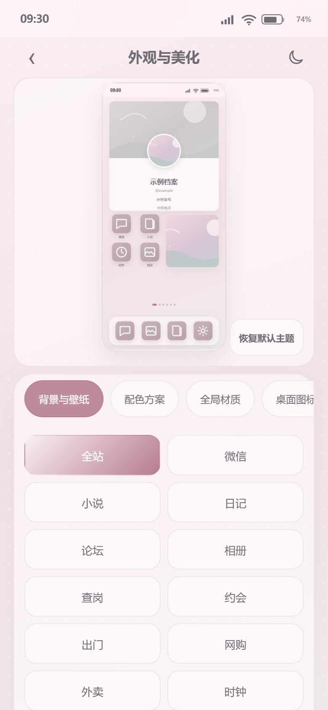
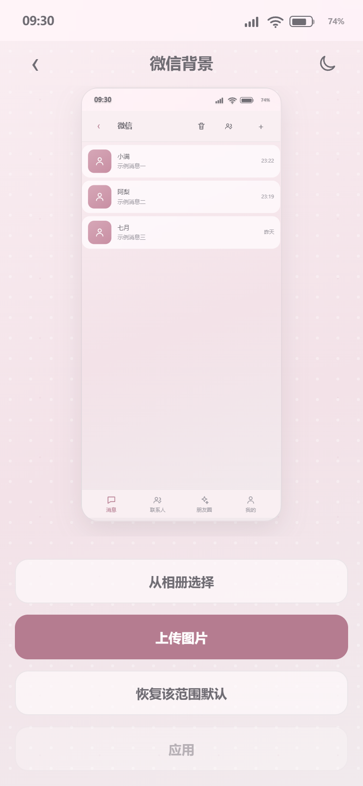
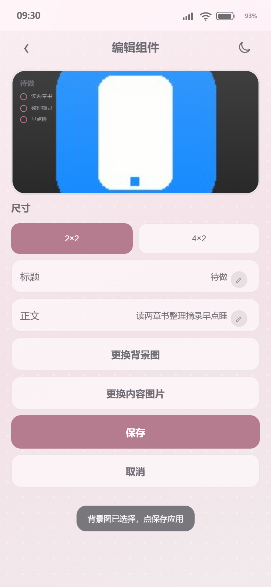
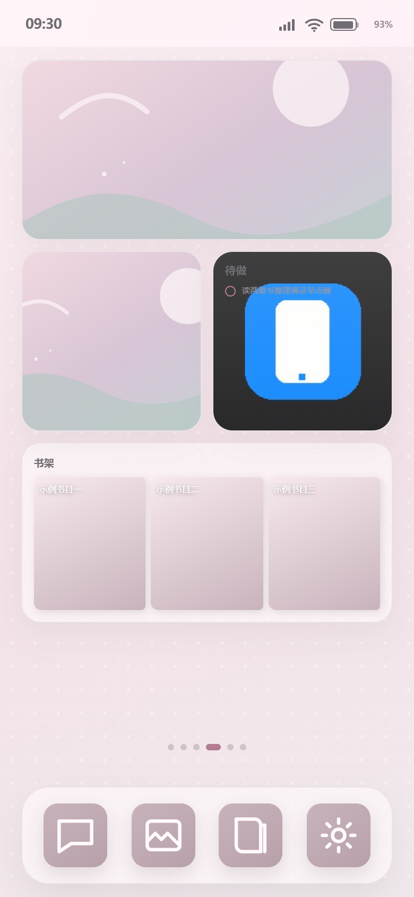
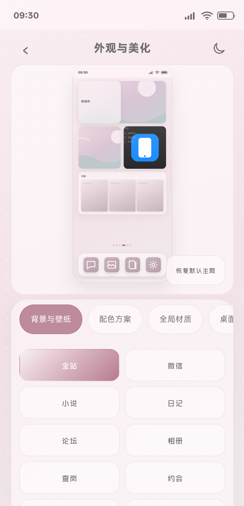
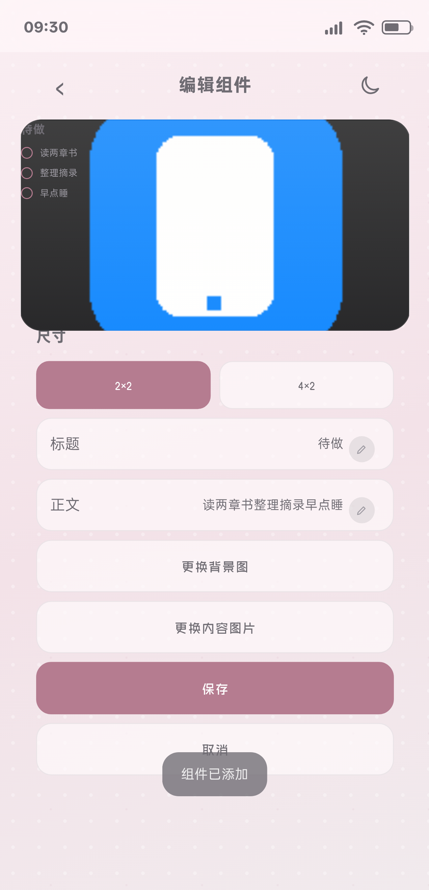
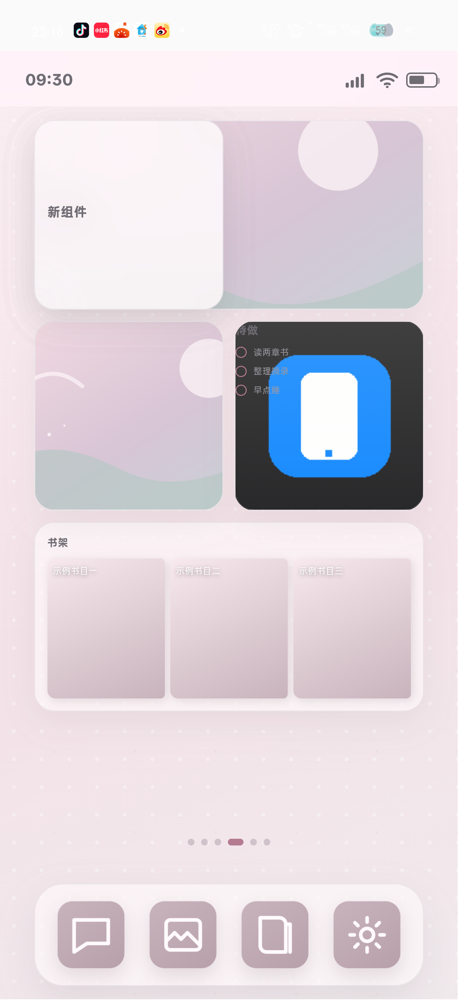

# BS 小手机 3.93 / Build104｜外观真实预览与组件背景图｜完整报告

日期：2026-11-09  
项目根目录：`C:\Users\lenovo\Documents\ChatGPT\各种的\_ghpages`  
候选版本：`3.93 / Build104`  
CacheKey：`bsphone-v104-20261109-r1`

## 1. 当前任务与对齐颗粒度

本轮任务不是只修一个按钮，而是完成“外观与美化 + 桌面组件底图”这一整个功能面：

1. 外观主页面保持已确认的整屏长页面结构；六标签单行横向滚动；不是卡片内部滚动。
2. 页标左侧只保留一个返回键，中间是“外观与美化”，右侧只有深色模式。
3. 实时预览使用固定尺寸，包含真实状态栏，桌面按 390×844 真实比例渲染。
4. “恢复默认主题”固定在实时预览区右下角，不回到页标。
5. 背景与壁纸显示全部 18 个 App 与“全站”；“APP内精修”继续存在。
6. APP 背景与 APP 内页面壁纸预览必须直接调用小手机真实 App 渲染函数，不能手绘、不能另写一套仿真 UI。
7. APP 内精修只列当前 App 真实存在的页面或 Tab，不保留没有真实页面承载的占位入口。
8. 14 种组件卡都必须能换背景图，包括清单、摘录、小记、月历、书架、相片三图、音乐播放、图片卡、大图等。
9. 上传底图后必须在编辑页立即看到；点击“保存”后写入 `DB.ui.userDesktopLayout`，刷新后仍存在。
10. 新增组件后，组件列表必须即时更新；不允许整页闪、标签丢失或必须刷新。
11. 所有预览与证据只使用示例数据；不得出现真实联系人、小说角色、笔名或私人 Handle。
12. 不修改 `core/store/core-store.js`、`core/store/readonly-store.js`、`core/prompts/sysworld-v2.js`，不破坏聊天、钱包、人设绑定数据流。

## 2. 任务进程

| 阶段 | 状态 | 结果 |
|---|---|---|
| 读取现存代码与旧状态 | 完成 | 确认 Build103 已有外观长页面基础，但组件底图编辑页预览缺失真实背景，部分卡型被材质背景覆盖 |
| 修复统一卡面背景 | 完成 | `udCardHTML` 统一附加 `ud-has-bg` 与 `--ud-bg-image`；新增独立 `::before` 背景层 |
| 修复组件编辑保存 | 完成 | 上传后即时预览；保存时才正式写入 Store；刷新后持久化 |
| 修复新增组件列表 | 完成 | 不整页重建，只更新组件面板并重新绑定按钮，保留当前标签 |
| 真实 App 预览 | 完成 | 18 个 App 主页面和 37 个真实内部页面/Tab 均调用现有 App 渲染函数 |
| APP 内精修收敛 | 完成 | 微博、查岗、情侣空间改为实际存在的 App Tab；去掉不存在的占位页 |
| 自动化回归 | 完成 | 13/13 模块与功能回归 PASS；4/4 外观专项 PASS |
| 真机巡检 | 完成 | OPPO PMK110 / Android 16；单独 QA 包侧载，未触碰主应用数据 |
| Release 安装 | 完成 | 3.93 / versionCode 104；安装哈希一致；首装时间未变化；运行时错误 0 |
| ZIP + assets | 完成 | 17 个归档条目；必填文件齐全；checksums 全部通过 |

## 3. 实际代码修改

### 3.1 组件卡背景图

关键位置：

- `index.html:2685`：`.ud-card.ud-has-bg::before` 独立背景层
- `index.html:6166`：`udCardHTML()` 统一把背景图写入卡面
- `index.html:12079`：组件编辑页预览使用同一卡面渲染
- `index.html:17586`：保存时写入 `backgroundImage`
- `index.html:17587`：上传后即时更新编辑页预览

修复原因：

- 旧实现只在大卡片外层设置 CSS 变量，编辑页只渲染 `udCardHTML(e)`，因此编辑页看不到底图。
- 部分卡型自带 `background` / 材质样式，会盖住外层背景。
- 新实现把背景图作为卡面统一状态，并用独立伪元素层显示；材质仍保留为轻量覆盖，不再吞掉图片。
- 14 种组件类型共用同一套逻辑，不再按卡型遗漏。

### 3.2 新增组件即时刷新

关键位置：

- `index.html:17564-17571`：`apBindWidgetButtons()` 统一绑定编辑、添加、排序、恢复默认
- 添加成功后只更新 `[data-ap-page="widgets"]`，再重新绑定按钮并刷新实时预览

结果：

- 组件行数 `16 → 17`
- 路由仍是 `appearance`
- 当前标签仍是 `widgets`
- 新组件立即可见且可点开编辑

### 3.3 真实 App 预览

关键位置：

- `index.html:12068`：`apInternalPages()` 按真实 App 页面/Tab 定义精修入口
- `index.html:12070`：`apActualAppHTML()` 调用现有 `screenWechat / screenNovel* / screenWeibo / screenHang / screenCouple / ...`
- `index.html:12078`：二级页面预览统一接入真实渲染

覆盖：

- 微信：消息、联系人、朋友圈、我的
- 小说：首页、书荒广场、书籍详情、阅读器、书架、小说主页、小说收益
- 微博：首页、发现、消息、我的
- 查岗：查手机、此刻动态
- 情侣空间：小家、纪念日、交换日记、相簿、情侣任务、一起做饭、互动
- 其余 13 个 App：各自的真实主页面

## 4. 截图证据

### 4.1 桌面与小屏预览

### 4.2 组件卡底图

### 4.3 真机 QA 包

## 5. 逻辑证据

### 5.1 18 个 App 主预览

证据：`docs/testing/round139-all-app-preview.json`

结果：

- `ok: true`
- App 数：18
- 每个 App 都注入渲染 sentinel，并确认外观页实际调用对应真实渲染函数
- 所有预览都无“预览暂不可用”
- 四个底部按钮全部可见，按钮高度均 ≥ 44
- 运行时错误：0

### 5.2 37 个真实内部页面/Tab

证据：`docs/testing/round139-internal-app-pages.json`

结果：

- `ok: true`
- 页面数：37
- `weiboTabsOk: true`
- `hangTabsOk: true`
- 所有标题、真实渲染 sentinel、按钮和空状态检查通过
- 运行时错误：0

### 5.3 14 种组件卡底图

证据：`docs/testing/round139-widget-background-all-types.json`

结果：

- `ok: true`
- 类型数：14
- 上传 → 裁切 → 编辑页预览：PASS
- 保存到 `backgroundImage`：PASS
- 刷新后读取：PASS
- 桌面卡面 `ud-has-bg`：PASS
- `::before` 背景图包含 `data:image`：14/14 PASS
- 直接 `udCardHTML` 输出带背景类与 CSS 变量：14/14 PASS

### 5.4 新增组件即时刷新

证据：`docs/testing/round139-widget-add-live.json`

结果：

- `rows: 16 → 17`
- `route: appearance`
- `active: widgets`
- 新“小记”行立即可见
- 新行可点击进入“编辑组件”
- PASS

## 6. 全量回归测试报告

### 6.1 模块、功能与外观完整批次

证据：`docs/testing/round139-full-regression-2026-11-09.log`

结果：13/13 PASS

1. 微信完整模块
2. 钱包模块
3. 银行卡手势
4. 新会话人设绑定
5. 全项目返回键审计
6. 财务导出审计
7. 银行卡响应式
8. 持久化审计
9. 全页面亮色/暗色回归
10. 18 个 App 真实主预览
11. 37 个真实内部页面/Tab
12. 14 种组件底图
13. 新增组件即时刷新

### 6.2 外观专项批次

证据：`docs/testing/round139-appearance-regression-2026-11-09.log`

结果：4/4 PASS

1. 外观规格与二级入口
2. 外观稳定性与横/纵滑
3. App 背景上传、裁切、应用与真实页面生效
4. 安全截图生成

## 7. 真机巡检

设备：

- 型号：OPPO PMK110
- Android：16
- 序列号：3B665K02PNH00000
- 巡检包：`com.xiaoshouji.app.qa`（独立 QA 包，已卸载）
- 主应用 `com.xiaoshouji.app` 的聊天、钱包、人设数据未用于巡检

证据：`docs/testing/round139-phone-appearance-audit.json`

关键测量：

- WebView CSS 视口：363 × 751，DPR 3.5
- 外观设置预览外层：331.14 × 344
- 实时手机预览：147.87 × 320
- 六标签：单行
- 标签最小点击高度：44.0000038
- 返回键：1 个
- 19 个背景范围入口
- 内部滚动容器：无
- 组件行：18 → 19，添加后仍在当前标签
- 编辑组件按钮高度：48
- 组件底图 `::before` 在真机 WebView 中包含 `data:image`
- 页面错误：0

Logcat：

- `docs/testing/round139-phone-logcat.txt`
- FATAL / ANR / Chromium JS Error：0

## 8. Release 安装与包体

证据：

- `docs/testing/round139-installed-release-audit.json`
- `docs/testing/round139-installed-release-package.txt`
- `docs/testing/round139-release-logcat.txt`
- `docs/testing/round139-release-package-audit.json`
- `docs/testing/round139-zip-verify.json`

Release 验证：

- 包名：`com.xiaoshouji.app`
- versionName：`3.93`
- versionCode：`104`
- 设备内 APK 哈希与候选 APK 一致
- firstInstallTime 保持：`2026-10-20 23:07:55`
- 应用启动后焦点为 `MainActivity`
- FATAL / ANR / Chromium JS Error：0

哈希：

- 源码 `index.html`：`4662C2B37057FD4026F8D266DDE94BB6031E07413D86EA6406A3E508DCC1088C`
- QA Debug APK：`6A3EB0FA4C6783B21FF35DA8B5444A0D53501A7CD530D1F199645EF049584235`
- Release APK：`3ACAEEF7F68930CB7EF10AC5FF81BAA187F801969A85E311DEC12F5A121A93E3`
- Release ZIP：`611FDBC0AE674AD0DD302D38936C42D5837E1CEF2A895B5F7321BDA7F276D10F`

交付文件：

- `BS小手机.apk`
- `BS小手机_3.93_Build104_release.zip`
- `_release_candidate_2026-11-09_Build104_pkg/BS小手机_3.93_Build104.apk`

ZIP 验证：

- 条目数：17
- 必填文件缺失：0
- checksums 不匹配：0
- `ok: true`

## 8.1 GitHub Pages 线上发布

证据：`docs/testing/round139-online-publish.json`

- GitHub Actions Pages 构建：成功
- 线上 `version.json`：3.93 / versionCode 104
- CacheKey：`bsphone-v104-20261109-r1`
- 线上 APK SHA-256 与本地 Release APK 一致：`3ACAEEF7F68930CB7EF10AC5FF81BAA187F801969A85E311DEC12F5A121A93E3`
- 线上 `index.html` 含 Build104
- 线上/本地 index 在统一换行符后 SHA-256 一致：`29EB73A1C0FE88671F14729B5E51D907FB7CDB8777F4E3BCD1953428A0A20132`

线上地址：

- 页面：https://blkst123.github.io/bsphone/?v=104-r1
- 版本清单：https://blkst123.github.io/bsphone/version.json
- APK：https://blkst123.github.io/bsphone/BS%E5%B0%8F%E6%89%8B%E6%9C%BA.apk
- Pages 构建记录：https://github.com/BLKST123/bsphone/actions/runs/42643700025
## 9. 隐私与数据隔离

本轮已执行：

- 删除/替换测试与预览中的真实联系人、小说角色、私人 Handle。
- 默认人物资料卡改为“示例档案 / 示例短句 / 示例地点 / @example”。
- 默认音乐、书架、摘录改为示例文案。
- 全项目文本证据隐私扫描通过。
- 真机巡检使用独立 QA 包，未读取或截图主应用聊天、钱包、人设数据。
- 未修改核心 Store、聊天、钱包和会话人设绑定代码。

## 10. 未改边界

本轮没有：

- 修改 `core/store/core-store.js`
- 修改 `core/store/readonly-store.js`
- 修改 `core/prompts/sysworld-v2.js`
- 改动聊天会话的人设绑定规则
- 改动钱包、银行卡账单归属
- 改动桌面图标外壳的 60×60 与既有圆角
- 新增 PRD 外页面说明文字或副标题

结论：本轮完整功能面、自动化回归、真机巡检、Release 安装和 ZIP 校验均完成。当前候选版本可以作为 3.93 / Build104 提交给红队与检查官复核。

