# BS 小手机 3.94 / Build105｜微信完整模块返修与组件卡底图回归｜完整报告

日期：2026-11-10  
源码目录：`C:\Users\lenovo\Documents\ChatGPT\各种的\_ghpages`  
版本：`3.94 / Build105`  
CacheKey：`bsphone-v105-20261110-r1`

## 1. 任务进程与交付范围

本轮不是单点修补，而是按“一个 APP 一个完整功能模块”处理微信，同时修复桌面组件卡底图引起的布局回归。

任务进程：

1. 读取现有状态、微信 PRD、页面地图、微交互清单和上一轮证据。
2. 复现并定位 12 项问题。
3. 修复消息卡片、后台生成、输入状态、会话命名、收藏、人设库、更多菜单、主题卡面、通话入口和组件底图布局。
4. 完成浏览器模块回归、外观回归和历史微信分支回归。
5. 构建 3.94 / Build105 Debug QA 与 Release。
6. 用独立 QA 包完成真机巡检，不接触主应用数据。
7. 覆盖安装最终 Release，核对版本、首装时间、APK 哈希和 logcat。
8. 生成 17 条目 ZIP + assets 并校验 checksums。

## 2. 用户语义对齐

### 2.1 角色结构化消息
- 角色发红包、转账、外卖、订单时，必须显示为消息卡片，不能只有普通文字。
- 实现结构化标记解析：`[红包]`、`[转账]`、`[外卖]`、`[订单]`。
- 模型输出“给你发了个 52 元红包”等自然语言时，也有本地兜底解析。
- 外卖卡片会创建本地角色外卖订单实体；通用订单卡片保留为聊天快照。

### 2.2 离开微信后继续生成
- 离开聊天页、退出微信、进入桌面或其它 App 时，不再 abort 当前角色生成请求。
- 生成完成后仍写入原会话，并更新未读和通知。
- 浏览器与真机均验证成功。

### 2.3 三秒状态与输入提示
- 重生成连续消息组时，临时忙碌提示最多显示 3 秒。
- 私聊标题固定显示 `对方正在输入……`，不带角色名。
- 生成结束后输入提示复位。

### 2.4 会话名称显示优先级
1. 有显式会话名称：显示会话名称。
2. 无显式会话名称、有角色备注：显示角色备注。
3. 无会话名称、无备注：显示角色原名。
4. 自动“会话 N”不算显式名称。

### 2.5 用户人设库
- 点击卡片进入编辑。
- 右侧图标启用人设。
- 启用人设后微信【我的】卡包数量立即刷新。
- 当前启用的人设显示启用图标。

### 2.6 收藏
- 收藏语音显示波形、时长和播放态，不再只显示转写文本。
- 每张收藏卡右上角有【更多】。
- 菜单提供“回到原会话”和“取消收藏”。
- 取消收藏二次确认。
- 回到原会话说定位到原消息。

### 2.7 聊天更多菜单
原按钮全部保留，分为六组：
- 会话外观
- 聊天方式
- 主动与记忆
- 生活联动
- 统计与诊断
- 会话管理
所有菜单按钮命中区至少 44px。

### 2.8 主题一致的卡片 UI
红包、转账、外卖、订单统一使用全局主题变量和材质，包括 `--accent`、`--theme-rose-deep`、`--deep`、`--card`、`--line`。修复了 `--deep` 未注入导致主题卡面无效的问题。

### 2.9 语音 / 视频通话入口
聊天页标保留语音、视频、更多三个图标，通话页面提供头像、名称、呼叫状态、静音、扬声器和挂断的视觉壳。当前不接实时音视频或 AI 视频。

### 2.10 单会话壁纸
上传和相册选择都先按聊天视口比例裁切，再以 `background-size:100% 100%` 显示，禁止二次 cover 放大。9:16 测试图输出比例与聊天视口完全一致。

### 2.11 组件卡底图布局
根因是背景层被插入为第一个子节点，破坏相片三图等 `nth-child` 样式。背景层已改为最后一个绝对定位子节点，不改变其它子节点顺序。

### 2.12 防破坏边界
未直接改动 `core/store/core-store.js`、`core/store/readonly-store.js`、`core/prompts/sysworld-v2.js`，未改聊天、钱包、银行卡、人设绑定底层数据流。

## 3. 关键代码位置
- 结构化卡片：`parseStructuredChatCard`、`inferStructuredChatCard`、`pushCharStructuredCard`
- 输入状态：`screenChatRoom`、`setTyping`
- 会话名称：`explicitSessionLabel`、`chatName`
- 收藏：`favoriteCardHTML`、`jumpToFavoriteSource`、`openFavoriteMenu`、`sheetFavs`
- 人设：`sheetPersona`、`setActivePersonaSafe`、`refreshWechatPersonaDerived`
- 组件底图：`udCardHTML`、`.ud-card-bg`
- 主题卡片：`.rp-redpacket`、`.rp-transfer`、`.takeout-msg`、`.order-msg`
- 通话壳：`sheetCallPlaceholder`

## 4. 截图证据
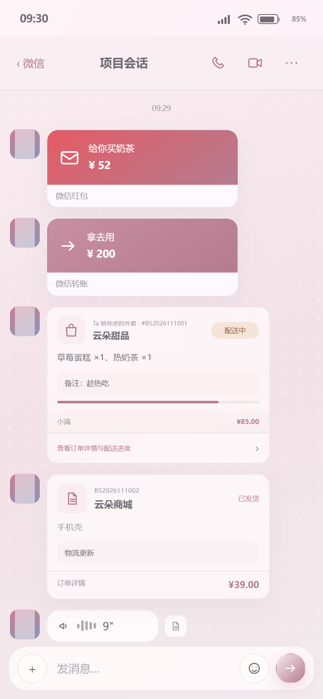
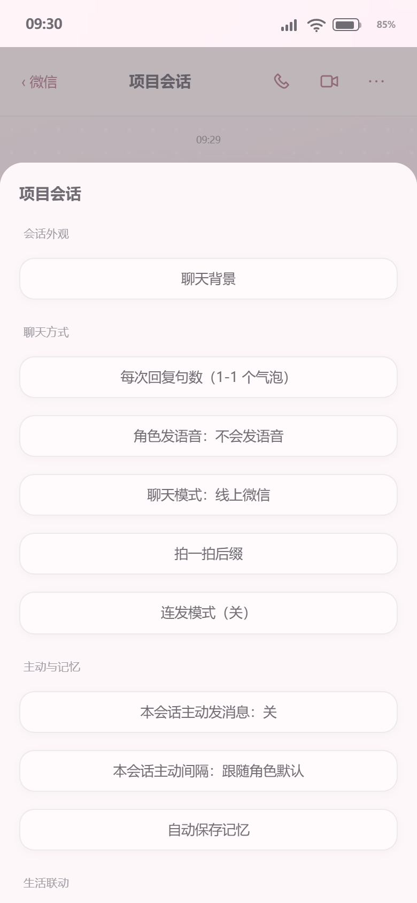
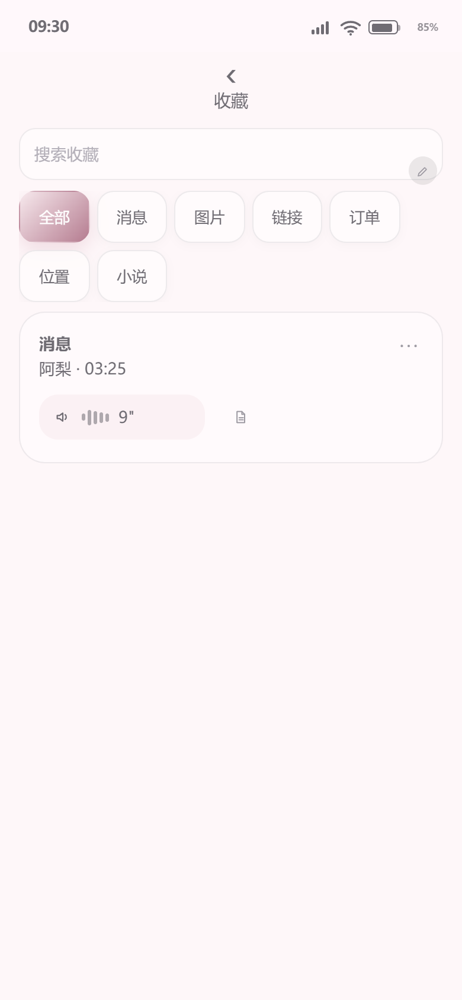
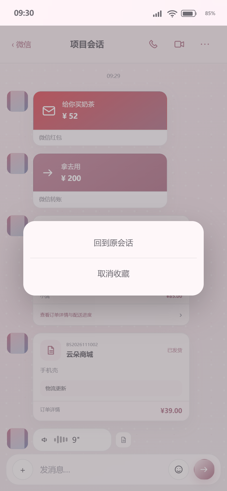

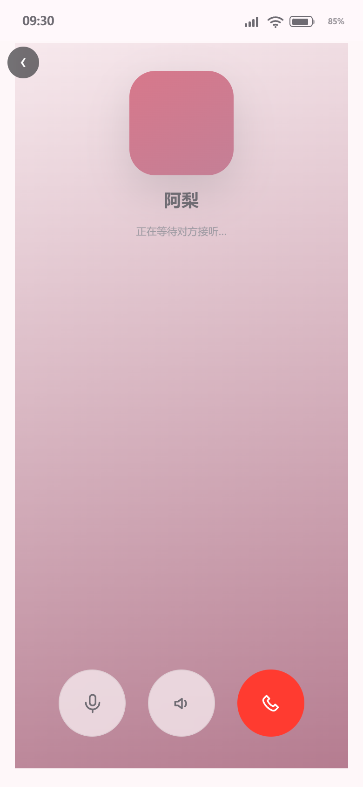
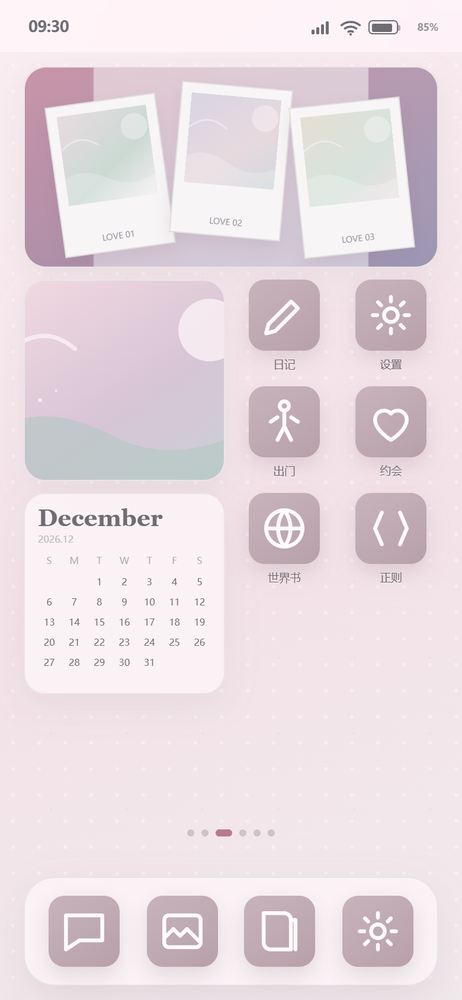

### 真机截图
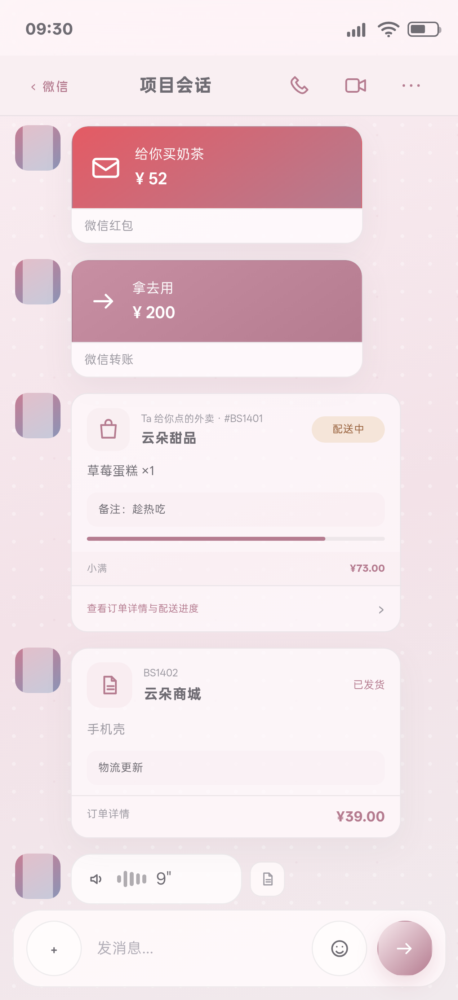
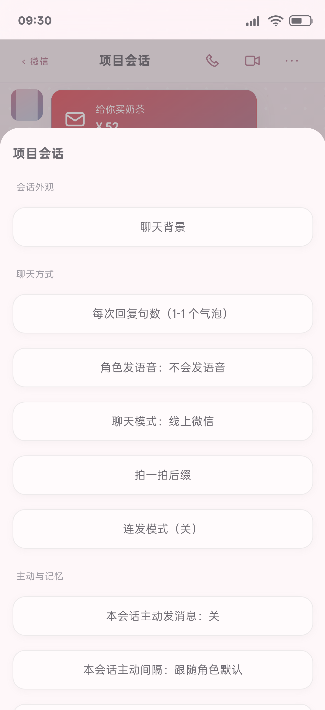
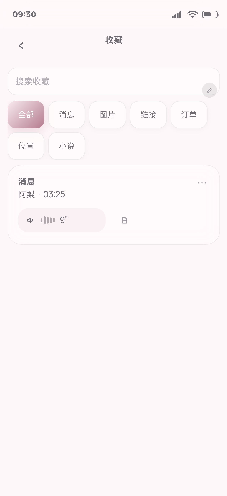
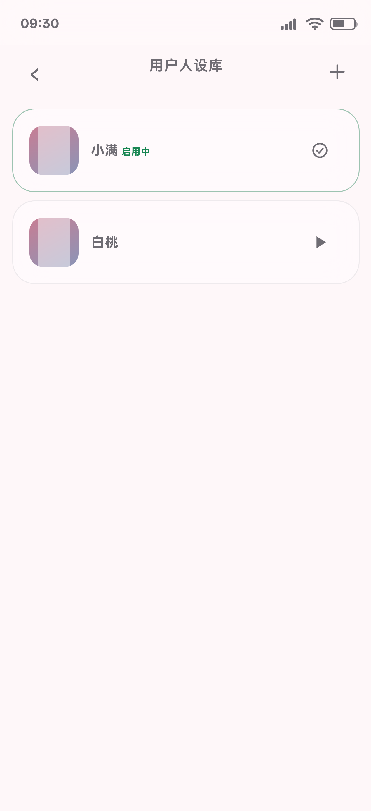
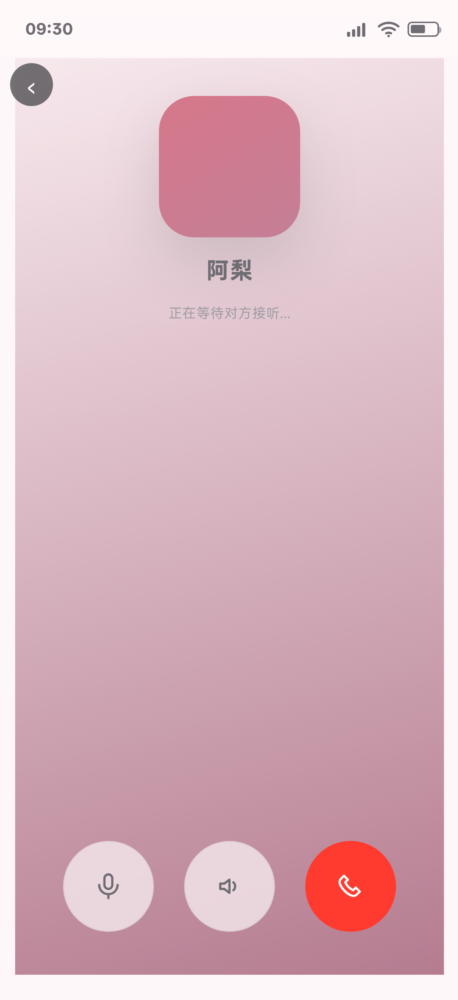
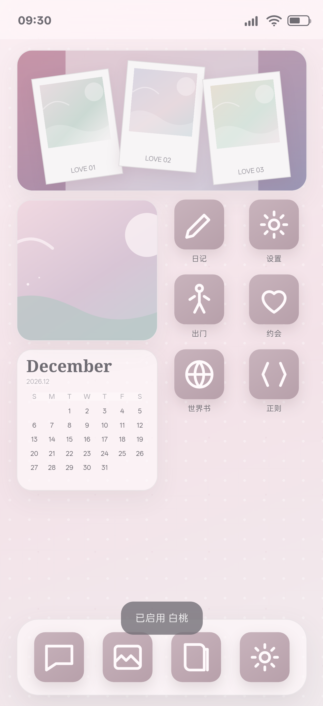
> 隐私返修说明：原 3.94 真机最终 ADB 截图已从公开仓库及历史中移除；3.95 返修使用合成数据截图。

## 5. 逻辑证据
- `docs/testing/round140-wechat-module-fix.json`：聊天命名、输入态、后台回复、卡片、菜单、人设、收藏、壁纸、组件、通话、toast 全 PASS。
- `docs/testing/round140-widget-geometry.json`：组件卡有/无底图尺寸、旋转、网格一致。
- `docs/testing/round140-card-theme.json`：四类消息卡片随主题变化。
- `docs/testing/round140-gallery-wallpaper.json`：相册选择裁切比例和 100% 铺满 PASS。
- `docs/testing/round140-phone-wechat-audit.json`：真机 Build105、六组菜单、44px 命中区、收藏、人设、通话、组件底图全 PASS，页面错误 0。
- `docs/testing/round140-phone-logcat-summary.json`：FATAL/ANR/JS Error 0。

## 6. 全量回归
### 当前模块全量批次
证据：`docs/testing/round140-full-regression-2026-11-10.log`
结果：**21/21 PASS**
覆盖微信完整模块、组件底图、主题卡面、相册壁纸、外观规格与稳定性、18 App 主预览、37 内部页面、14 组件类型、添加组件即时刷新、全页亮暗回归、桌面卡片编辑持久化、微信我的/钱包/银行卡/新会话/返回键、财务导出、响应式、持久化。

### 微信历史分支回归
证据：`docs/testing/round140-wechat-branch-regression-2026-11-10.log`
结果：**10/10 PASS**
覆盖连续组 reroll、分支导出删除、忘记分支记忆、群聊备注作用域、混合组编辑、自动记忆分支、Prompt 分层、分支切换 UI、图片分支/隐藏/ZIP、隐藏内容 Prompt 隔离。

旧脚本 `_round123_wechat_mine_ui_qa_test.cjs` 仍引用已删除的旧钱包控件 `#wl_amount/#wlAddBill`，当前钱包验收由 `_round124_wallet_test.cjs` 覆盖并 PASS。

## 7. 真机巡检
- 设备：OPPO PMK110 / Android 16
- QA 包：`com.xiaoshouji.app.qa`
- QA 版本：3.94 / Build105
- QA 使用合成示例数据，巡检后已卸载
- 真机视口：363×792
- 聊天页三个页标按钮：44.0000038px
- 六组菜单全部按钮 ≥44px
- 页面错误 0
- logcat FATAL / ANR / Chromium JS Error 0

## 8. Release 与发布包
- 包名：`com.xiaoshouji.app`
- versionName：3.94
- versionCode：105
- 设备内 APK 哈希与候选一致
- firstInstallTime 保持：`2026-10-20 23:07:55`
- 启动焦点：MainActivity
- FATAL / ANR / Chromium JS Error 0

哈希：
- 源码：`4BC33B602F783D034E93C791C5D9D79D291F477567A13CE72E944EE9409F35CB`
- QA Debug APK：`D1AAC85E7F3A7136B651F2382C0410DC84DDAF8093EB8D6C55F157D5712EE01C`
- Release APK：`2B88953B4D85F6030BDB4497D9955C3C7D631F64CBCCCBFAF84D7CD7DD4E959D`
- Release ZIP：`EB6E827030DC926A49DF8ABE614F40C65C3729DD1226150EB6DB33D0CBD83778`

ZIP：17 entries；必填缺失 0；checksums 不匹配 0；`ok: true`。

## 8.1 GitHub Pages 线上发布
- Pages 构建：成功
- 线上版本：3.94 / versionCode 105
- CacheKey：`bsphone-v105-20261110-r1`
- 线上 APK SHA-256 与本地 Release 一致：`2B88953B4D85F6030BDB4497D9955C3C7D631F64CBCCCBFAF84D7CD7DD4E959D`
- 线上/本地 index 规范化哈希一致
- 证据：`docs/testing/round140-online-publish.json`
- 页面：https://blkst123.github.io/bsphone/?v=105-r1
- Pages 构建记录：https://github.com/BLKST123/bsphone/actions/runs/42684398927
## 9. 隐私
- 本轮截图和测试数据使用：阿梨、小满、白桃、示例语音、示例银行。
- 不使用真实联系人、小说角色、笔名、私人 Handle 或真实聊天内容。
- QA 过程未读取主应用聊天、钱包和人设数据。

## 10. 主队局限与未完成边界
1. 通话页只是视觉入口壳，没有真实音视频、麦克风、摄像头或 AI 视频。
2. 角色结构化卡片依赖模型遵循标记格式；本地有自然语言兜底，但不能保证任意散文描述都准确识别成卡片。
3. 通用“订单”卡片是聊天快照，不自动写入网购订单数据库；外卖卡片会创建本地外卖订单。
4. 收藏原消息若已不在当前分支或已隐藏，只提示不可定位，不强行切换旧分支。
5. 本轮没有新增产品经理未确认的通话交互、扣费或实时媒体能力。
6. 其它 App 仍需按各自 PRD 做独立完整模块验收。

## 11. 交付文件
- `C:\Users\lenovo\Documents\ChatGPT\各种的\_ghpages\BS小手机.apk`
- `C:\Users\lenovo\Documents\ChatGPT\各种的\_ghpages\BS小手机_3.94_Build105_release.zip`
- `C:\Users\lenovo\Documents\ChatGPT\各种的\_release_candidate_2026-11-10_Build105_pkg`

