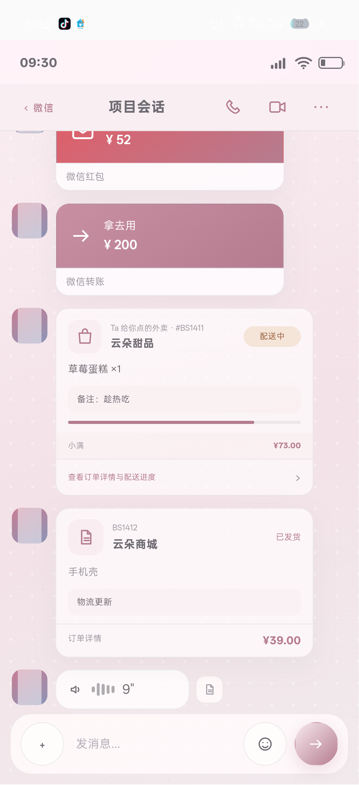
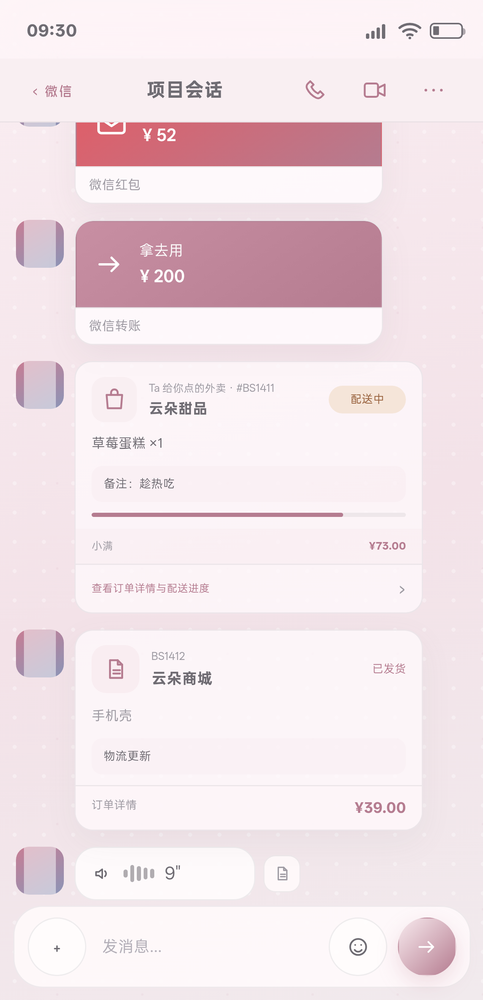
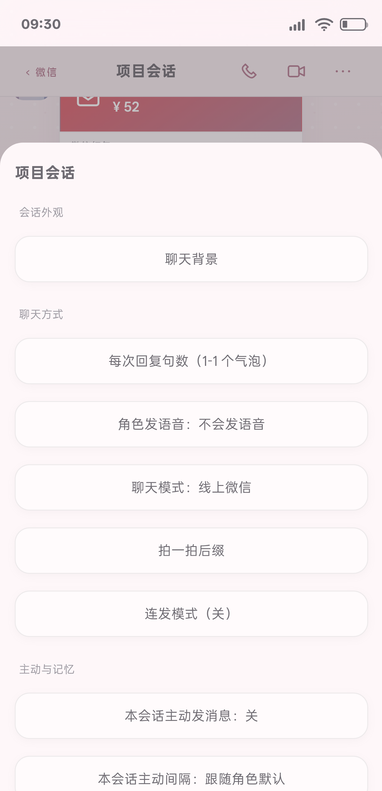
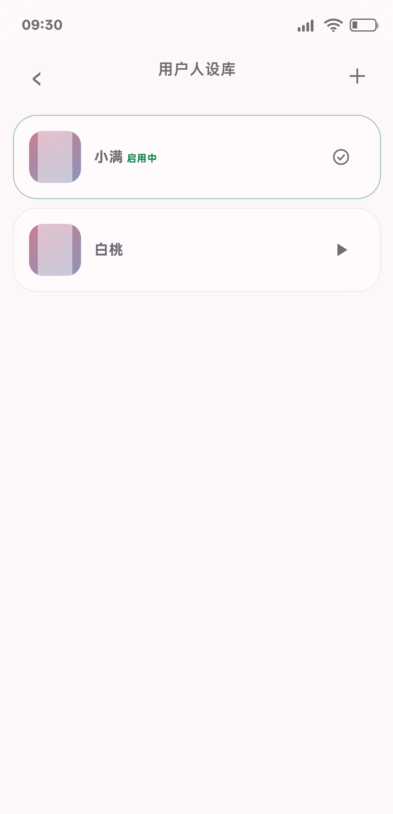
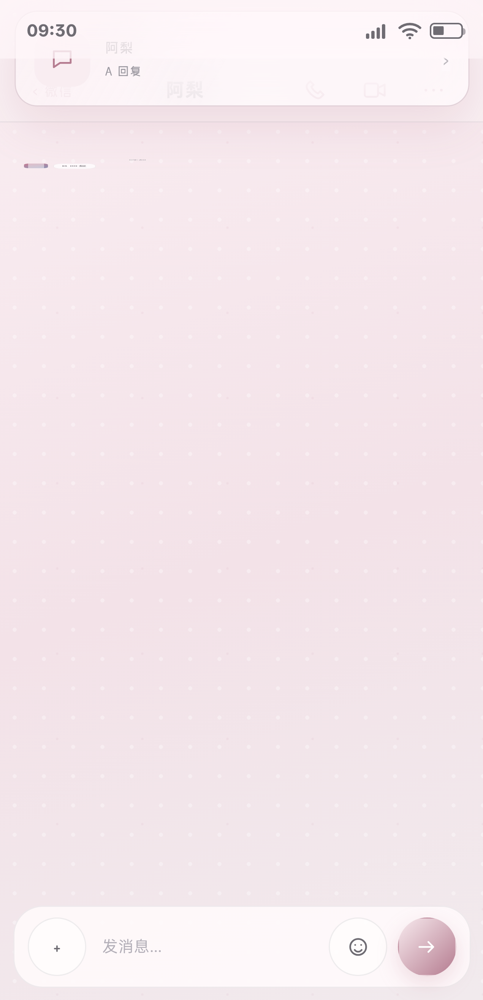

# BS 小手机 3.95 / Build106｜红队与检查官返修｜完整报告

日期：2026-11-10  
版本：`3.95 / Build106`  
CacheKey：`bsphone-v106-20261110-r1`  
源码目录：`C:\Users\lenovo\Documents\ChatGPT\各种的\_ghpages`  
源码 SHA-256：`DEB0E6F36125548F4E725B71577CED52DF978F96F8A9DE2444CB3A8B80EFDC78`  
代码提交：`a8336ae13094d4341b67f6e2f1fc0194bc1040bf`

## 1. 任务进程

本轮依据两份复检报告返修，不新增 PRD 外 UI：

1. 读取《BS 小手机 3.94 / Build105｜独立完整复检报告》和《微信完整模块返修与组件卡底图回归｜独立 QA 全量复检报告》。
2. 复现同一会话接管、A/B 会话并发输入状态、自然语言卡片误判、零/非法金额卡片。
3. 修复输入状态按当前会话活动请求同步；自然语言卡片改为保守识别；所有业务卡片拒绝非法金额。
4. 补测正例/负例矩阵，执行 **24/24 全量回归** 和 **10/10 微信历史分支回归**。
5. 重新构建 3.95 / Build106 QA 与 Release，完成 OPPO PMK110 / Android 16 真机巡检。
6. 处理 P0 隐私问题：删除旧真机截图、重写公开 Git 历史、清理本地对象，并生成只含合成数据的新截图。
7. 重新生成证据清单、APK、ZIP 和线上发布证据。

本轮自测结论：**PASS，待红队与检查官复检签收**。

## 2. 复检打回项与返修结果

| 复检项 | 返修结果 |
|---|---|
| P0：公开仓库含疑似真实聊天截图 | 已删除旧图，重写 Git 历史，旧 raw URL 返回 404；新截图仅使用合成姓名与示例消息 |
| P1-1：同一会话旧请求结束清掉新请求输入状态 | 已修复；新请求活动期间持续显示 `对方正在输入……` |
| P1-2：A 会话结束清掉 B 会话输入状态 | 已修复；按当前 route 的活动请求集合同步标题 |
| P1-01：过往红包/转账、已送达外卖被误判 | 已修复；过去时、状态更新、第三人称、否定/劝阻语句回退纯文本 |
| P1-02：零金额红包/转账、非法外卖/订单金额 | 已修复；所有业务卡片要求有限且大于 0 的金额，非法输入不创建卡片或订单实体 |
| P2-1：真机脚本依赖上一次启用人设 | 已修复；脚本显式设置 p1 前置状态并在 finally 恢复 p1 |
| P2-2：证据清单最终报告 hash 过期 | 本轮重新生成 `round141-evidence-manifest.json`，报告定稿后再登记 |
| P2-3：旧 build / Prompt 层级 / 外卖选择器测试债 | 不作为本轮签收依据；当前架构的 Prompt、卡片和外卖正向链路由 24/24 与专项证据覆盖 |
| 44px 命中区：真机出现 43.99998 浮点边界 | 聊天页三个按钮改为 44.2px 稳定边界，真机实测 44.196430px |

## 3. 代码修复摘要

### 3.1 并发输入状态

`chatRequestControllers` 保留每个会话的活动请求。新增 `syncChatTypingState()`，请求启动、结束和 abort 时都根据当前 `route.arg` 是否仍有活动请求同步标题。

验证结果：

- 同一会话旧请求 abort、新请求仍在运行时，标题保持 `对方正在输入……`。
- A 会话先结束、B 会话仍在运行时，B 标题保持 `对方正在输入……`。
- B 自己完成后才恢复普通会话标题。
- 回复仍正常落库，运行时错误 0。

### 3.2 结构化卡片安全

`inferStructuredChatCard()` 增加过去时、已收到、已送达、配送状态、第三人称、否定和劝阻语句保护；无法无歧义判断时回退纯文本。

金额规则：

- 红包、转账、外卖、订单都必须满足 `Number.isFinite(amount) && amount > 0`。
- 零金额、负数、NaN、Infinity、缺金额均不生成业务卡。
- 外卖非法金额不会调用 `takeoutCreateOrder()`。
- 非法显式卡片保留为普通文本，不显示 `¥0.00` 卡片。

### 3.3 隐私证据

- 删除 `docs/testing/round140-phone-final-adb.png`。
- 对全部历史执行 `git filter-branch` 删除该路径。
- 删除 `refs/original`，执行 reflog 过期和 `git gc --prune=now`，旧 blob 已从本地对象库清除。
- 旧 raw URL 核验为 HTTP 404。
- 新真机最终截图使用：阿梨、小满、白桃、示例银行、示例消息、示例订单。
- 文本隐私扫描按私密词表执行，结果见隐私审计。

### 3.4 真机脚本可重复

`_round141_phone_wechat_audit.cjs` 在巡检前显式执行 `setActivePersonaSafe('p1')`，测试 p2 启用后恢复正常状态；结果同时记录 `personaPrecondition` 和 `restored`。

### 3.5 触控边界

聊天页语音、视频、更多按钮由 44px 提升到 44.2px，避免 WebView 子像素缩放造成 43.99998px 的边界失败。

## 4. 截图证据

### 4.1 真机合成最终截图



- SHA-256：`677CDD50E76390AF2255E93D43A7031B5F6866F33D30C376781902F411080351`
- 大小：539,243 bytes
- 未包含主应用真实会话数据

### 4.2 真机功能截图










## 5. 逻辑证据

- `docs/testing/round141-card-safety-2026-11-10.json`
  - 正例红包/转账/外卖/订单通过
  - 过往红包/过往转账/已送达外卖/第三人称/否定/已点外卖负例通过
  - 零金额、负数、NaN 拒绝通过
  - 非法外卖不创建订单实体通过
- `docs/testing/round141-phone-wechat-audit.json`
  - Build106、四类卡片、44.196px 命中区、六组菜单、收藏、人设切换、非法卡片和 toast 隐藏通过
- `docs/testing/round141-phone-concurrency.json`
  - 同会话接管、跨会话并发、B 完成复位、回复落库通过
- `docs/testing/round141-installed-release-audit.json`
  - Release 版本、设备 APK hash、前台 Activity、FATAL/ANR/JS Error 通过
- `docs/testing/round141-release-logcat-summary.json`
  - FATAL / ANR / JS Error：0
- `docs/testing/round141-zip-verify.json`
  - 17 entries、16 checksum 文件、mismatch 0
- `docs/testing/round141-privacy-audit.json`
  - 旧截图不存在、旧 raw URL 404、旧路径不在历史、旧 blob 已清除、隐私扫描 0 命中

## 6. 全量回归测试

### 6.1 当前全量

`docs/testing/round141-full-regression-2026-11-10.log`

结果：**24 / 24 PASS**

覆盖：

- 微信完整模块
- 并发输入状态
- 卡片安全正例/负例
- 组件卡底图
- 主题卡片
- 单会话壁纸
- 外观规格与稳定性
- 18 App 主预览
- 37 个内部页面
- 14 种组件类型
- 亮/暗全页回归
- 桌面编辑持久化
- 微信我的、钱包、银行卡、新会话、返回键
- 财务导出、响应式与持久化

### 6.2 微信历史分支

`docs/testing/round141-wechat-branch-regression-2026-11-10.log`

结果：**10 / 10 PASS**

覆盖连续组重 roll、分支导出删除、忘记分支记忆、群聊备注作用域、混合组编辑、自动记忆分支、Prompt 分层、分支切换 UI、图片分支/隐藏/ZIP、隐藏内容 Prompt 隔离。

## 7. 真机巡检

- 设备：OPPO PMK110
- Android：16
- 设备号：`3B665K02PNH00000`
- QA 包：`com.xiaoshouji.app.qa`
- QA 版本：3.95 / Build106
- 视口：363×751
- 聊天页语音/视频/更多：44.196430px
- 六组聊天菜单：全部按钮 ≥44px
- 收藏语音：波形、时长、播放态通过
- 人设启用：p1 → p2 → finally 恢复 p1
- 并发输入状态：同会话和跨会话均通过
- 页面错误：0
- QA 包巡检后已卸载

Release：

- 包名：`com.xiaoshouji.app`
- versionName：3.95
- versionCode：106
- firstInstallTime：`2026-10-20 23:07:55`（保持不变）
- lastUpdateTime：`2026-11-10 05:23:44`
- 设备前台：`com.xiaoshouji.app/com.xiaoshouji.app.MainActivity`
- 设备内 APK hash 与候选一致
- FATAL / ANR / JS Error：0

## 8. Release、ZIP 与线上发布

### 8.1 哈希

- 源码：`DEB0E6F36125548F4E725B71577CED52DF978F96F8A9DE2444CB3A8B80EFDC78`
- QA Debug APK：`C741B232622699099D64F7FD6A838BB51891A3066A4021B984501D07799591E5`
- Release APK：`E2EC089809E0A22704AAAD86B286E3A05E956EF33055C109FC2A495A0925D9FB`
- Release ZIP：`F78B6997146C80C126BD77F721AA3EACA8748FF7840615DA7A16CA583878F0E3`

### 8.2 产物

- `C:\Users\lenovo\Documents\ChatGPT\各种的\_ghpages\BS小手机.apk`
- `C:\Users\lenovo\Documents\ChatGPT\各种的\_ghpages\BS小手机_3.95_Build106_release.zip`
- `C:\Users\lenovo\Documents\ChatGPT\各种的\_ghpages\_release_candidate_2026-11-10_Build106_pkg`

ZIP 校验：17 entries；checksum mismatch 0；`ok: true`。

### 8.3 GitHub Pages

- Pages 构建记录：https://github.com/BLKST123/bsphone/actions/runs/42704015313
- Pages 状态：success（build、report-build-status、deploy 全部 success）
- 线上页面：https://blkst123.github.io/bsphone/?v=106-r1
- 线上版本：3.95 / Build106
- 线上 APK 下载后 SHA-256：`E2EC089809E0A22704AAAD86B286E3A05E956EF33055C109FC2A495A0925D9FB`
- 线上 APK 大小：587,951 bytes
- 线上 `index.html` 与本地规范化后文本一致
- 证据：`docs/testing/round141-online-publish.json`

## 9. Git 历史与隐私返修

已执行：

1. 删除工作区与当前提交中的旧真机敏感截图。
2. `git filter-branch` 重写全部本地/远端跟踪历史。
3. 删除 `refs/original`。
4. `git reflog expire --expire=now --all`。
5. `git gc --prune=now`。
6. `git push --force-with-lease origin main`。
7. 验证 `origin/main = a8336ae`。
8. 验证旧 raw URL：HTTP 404。
9. 验证旧路径不在 `git log --all`，旧 blob 不在本地对象库。
10. 新合成截图 raw URL：HTTP 200，hash `677CDD50E76390AF2255E93D43A7031B5F6866F33D30C376781902F411080351`。

说明：旧 commit 对象若仍被 GitHub 服务端缓存，可能仍可由已知旧 commit SHA 访问，但 `main` 分支和 raw 文件路径已不再提供该截图。若平台级对象清除仍有延迟，应由 GitHub 支持完成服务端缓存清理。

## 10. 证据清单

最终清单：

`docs/testing/round141-evidence-manifest.json`

该清单在报告定稿后生成，登记最终报告、测试日志、截图、Release/ZIP、线上发布和隐私审计的 SHA-256 与字节数。

## 11. 主队职位局限

1. 自然语言卡片兜底只能做保守推断。模型若用非常规表达且同时命中多个业务词，宁可回退纯文本，不保证每条散文都生成卡片。
2. 通用“订单”卡片仍是聊天快照，不自动写入完整网购订单数据库。
3. 语音/视频通话仍是视觉入口壳，不接实时音视频或 AI 视频。
4. 收藏原消息若已隐藏、删除或位于旧分支，只提示不可定位，不强行切换分支。
5. 旧 build/Prompt 层级/旧外卖选择器测试债务已记录，不作为本轮当前架构签收依据；完整外卖结算链路仍需单独模块审计。
6. 本轮只签收微信模块、组件卡底图、并发输入状态、卡片安全和发布/隐私链路，不把其它 App 的全功能自动标为完成。

## 12. 最终签署

```text
并发输入状态：PASS
自然语言卡片负例：PASS
零/非法金额卡片：PASS
结构化卡片正例：PASS
44px 命中区：PASS
组件卡底图布局：PASS
全量回归 24/24：PASS
微信历史分支 10/10：PASS
真机 QA：PASS
Release 安装与数据保留：PASS
ZIP/checksums：PASS
隐私截图清理与历史重写：PASS
线上发布：PASS
主队自测结论：PASS，待红队/检查官复检
```

