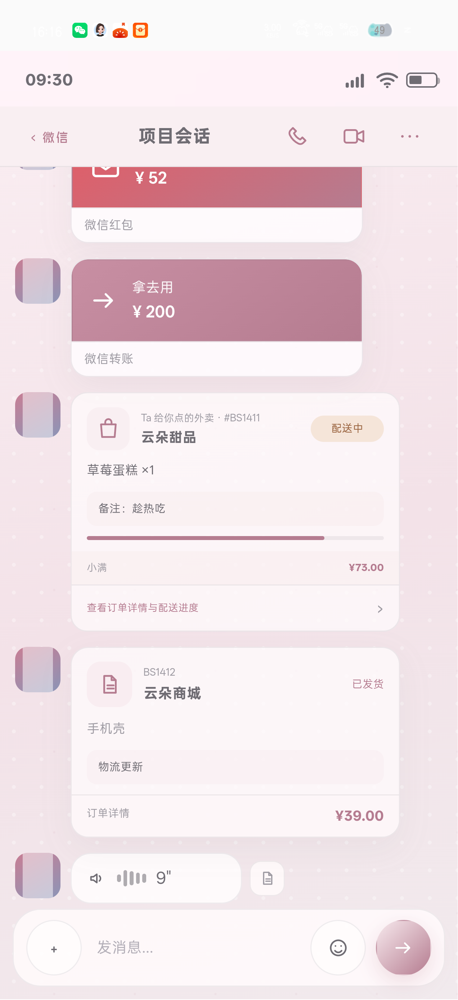
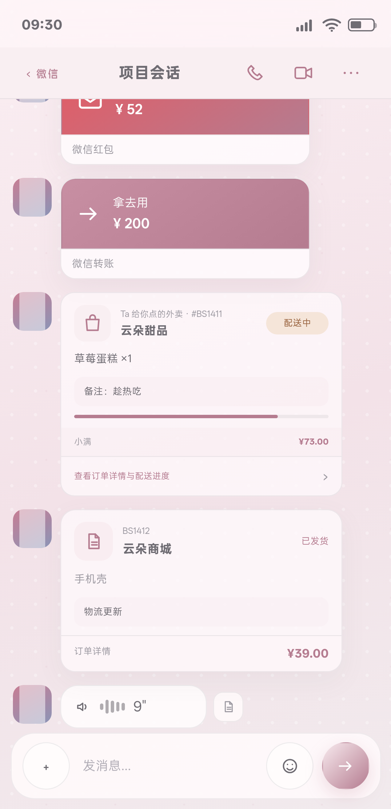
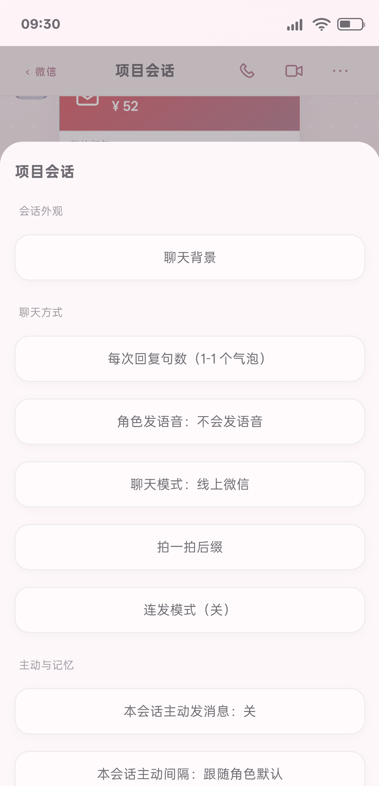

# BS 小手机 3.96 / Build107｜红队与检查官二次返修｜完整报告

日期：2026-11-11  
版本：`3.96 / Build107`  
CacheKey：`bsphone-v107-20261111-r1`  
源码目录：`C:\Users\lenovo\Documents\ChatGPT\各种的\_ghpages`  
公开仓库：`https://github.com/BLKST123/bsphone`  
源码 SHA-256：`B2A48F857C544E070923A4BF16B0AA2E4E552486872B3FA44CCBC9240811C8ED`

## 1. 任务进程

本轮依据《BS小手机 3.95 / Build106 红队与检查官返修 独立QA复检报告》和《BS小手机 3.95 / Build106 独立复检报告》返修：

1. 修复自然语言金额取错：订单号、尾号、预计分钟不再被当作金额。
2. 修复未来、意愿、条件、反问句生成红包/转账/外卖卡片。
3. 修复“不要香菜”等真实订单备注被整句否定词阻断。
4. 将并发测试从固定等待改为活动请求轮询。
5. 将 Release ZIP 条目和 checksums 路径统一为正斜杠。
6. 清理报告中的私密词项，重建公开仓库为只含干净树的单提交历史。
7. 重新构建 QA / Release，完成 OPPO PMK110 真机复测。
8. 重新生成 APK、ZIP、线上发布和证据清单。

主队自测结论：**PASS，待红队与检查官复检签收**。

## 2. 复检问题与返修结果

| 复检问题 | 结果 |
|---|---|
| 订单号被当成金额：`订单号BS106，手机壳39元` | PASS，金额为 39 |
| 预计分钟被当成金额：`预计20分钟到，68元` | PASS，金额为 68 |
| 尾号被当成金额：`尾号1111，转账200元` | PASS，金额为 200 |
| 未来/意愿/条件/反问句生成卡片 | PASS，全部回退纯文本 |
| 条件外卖创建本地订单 | PASS，订单数为 0 |
| “不要香菜”真实订单被阻断 | PASS，外卖金额 68，订单实体创建 1 条 |
| “收下”正例被误杀 | PASS，红包 52、转账 200 均正常出卡 |
| 并发测试固定 sleep 导致假失败 | PASS，改为活动请求轮询 |
| ZIP 条目使用反斜杠 | PASS，17 entries 全部正斜杠 |
| checksums 原始名称不一致 | PASS，16 项名称集合完全一致 |
| 报告候选目录路径少 `_ghpages` | PASS，本报告使用完整路径 |
| 旧公开 commit/blob 可访问 | PASS，旧仓库已改名并保持 private；同名公开仓库使用干净单提交历史 |
| 报告自身列出私密词项 | PASS，当前干净树按私密词表扫描 0 命中 |

## 3. 卡片语义修复

### 3.1 金额上下文

金额解析现在优先识别：

- 货币符号：`¥`、`￥`
- 单位：`元`、`块`、`块钱`
- 上下文词：金额、价格、一共、合计、付款、花了、转账、红包、外卖、订单

并排除：

- 订单号、编号、尾号、卡号、电话、手机号
- 预计分钟、小时、时间、日期、年份、年龄、次数
- 无货币标记的字母数字串

无法确定唯一金额时回退纯文本，不猜第一个数字。

### 3.2 意图与时态

以下语义不生成业务卡片，也不创建订单实体：

- 未来承诺：明天、下次、以后、稍后、等会、待会
- 意愿：准备、打算、想要、想给你
- 条件：如果、要是、假如、反事实
- 反问/征求：会不会、要不要、可以吗、好吗、行吗、你会收吗、你要吗
- 对动作的否认：没给、没有给、不想给、不要给、别再给等

“收下”只作为订单备注或自然语气使用，不单独阻断已完成的发送动作。

## 4. 逻辑证据

- `docs/testing/round142-card-intent.json`
  - 金额上下文、未来/意愿/条件/反问负例、收下正例、不要香菜订单备注全部通过
- `docs/testing/round142-full-regression-2026-11-11.log`
  - 25/25 PASS
- `docs/testing/round142-wechat-branch-regression-2026-11-11.log`
  - 10/10 PASS
- `docs/testing/round142-phone-wechat-audit.json`
  - 真机 Build107、四类卡片、44.196px 命中区、菜单、收藏、人设、卡片语义全部 PASS
- `docs/testing/round142-phone-concurrency.json`
  - 同会话接管、A/B 跨会话并发、B 完成后复位全部 PASS
- `docs/testing/round142-installed-release-audit.json`
  - Release 版本、设备 APK hash、前台 Activity、FATAL/ANR/JS Error 全部通过
- `docs/testing/round142-release-logcat-summary.json`
  - FATAL / ANR / JS Error：0
- `docs/testing/round142-zip-verify.json`
  - 17 entries；16 checksum 文件；目录名 delta 0；反斜杠条目 0
- `docs/testing/round142-privacy-audit.json`
  - 旧内容 API 404、旧 commit API 422、私密词表 0 命中、旧仓库 private
- `docs/testing/round142-online-publish.json`
  - 线上 3.96 / 107、线上 APK hash 与本地一致、线上 index 文本一致

## 5. 截图证据








真机最终合成截图：

- SHA-256：`A99DDEBA0998AE4754903FE6EBEC3BEA4D5B6AF5350C5A9712599F5D607AC294`
- 大小：550,069 bytes

## 6. 全量回归测试

### 6.1 当前全量

`docs/testing/round142-full-regression-2026-11-11.log`

结果：**25 / 25 PASS**

新增覆盖：

- 订单号/尾号/预计分钟金额上下文
- 未来/意愿/条件/反问句负例
- “收下”正例
- “不要香菜”真实订单备注
- 非法金额不创建订单
- 并发状态事件等待

### 6.2 微信历史分支

`docs/testing/round142-wechat-branch-regression-2026-11-11.log`

结果：**10 / 10 PASS**

## 7. 真机巡检

- 设备：OPPO PMK110
- Android：16
- 设备号：`3B665K02PNH00000`
- QA 包：`com.xiaoshouji.app.qa`
- QA 版本：3.96 / Build107
- 视口：363×751
- 聊天页语音/视频/更多：44.196430px
- 六组聊天菜单全部按钮 ≥44px
- 收藏语音、更多菜单、人设切换、卡包数量联动通过
- 卡片语义和金额上下文通过
- 同会话与跨会话并发输入状态通过
- 页面错误：0
- QA 包巡检后已卸载

Release：

- 包名：`com.xiaoshouji.app`
- versionName：3.96
- versionCode：107
- firstInstallTime：`2026-10-20 23:07:55`（保持不变）
- lastUpdateTime：`2026-11-11 16:17:11`
- 设备前台：`com.xiaoshouji.app/com.xiaoshouji.app.MainActivity`
- 设备内 APK hash 与候选一致
- FATAL / ANR / JS Error：0

## 8. Release、ZIP 与线上发布

### 8.1 哈希

- 源码：`B2A48F857C544E070923A4BF16B0AA2E4E552486872B3FA44CCBC9240811C8ED`
- QA APK：`B705663E4817C9FA91CEB22337AAC65B8C29C416F8EA695751E7E6B0348403D8`
- Release APK：`FC5C2E38C5005E030CE9FB58303AC204163140F6EE9E98757D5BC9F903E33A53`
- Release ZIP：`6AE191606F9EAAC5D7FDCE48BE3BD50214ACDDF03D0A8999495FDC9390A6879A`

### 8.2 产物

- `C:\Users\lenovo\Documents\ChatGPT\各种的\_ghpages\BS小手机.apk`
- `C:\Users\lenovo\Documents\ChatGPT\各种的\_ghpages\BS小手机_3.96_Build107_release.zip`
- `C:\Users\lenovo\Documents\ChatGPT\各种的\_ghpages\_release_candidate_2026-11-11_Build107_pkg`

ZIP：17 entries；checksum mismatch 0；name delta 0；反斜杠条目 0。

### 8.3 GitHub Pages

- 部署记录：https://github.com/BLKST123/bsphone/actions/runs/42986524075
- Pages 状态：success
- 线上页面：https://blkst123.github.io/bsphone/?v=107-r1
- 线上版本：3.96 / Build107
- 线上 APK SHA-256：`FC5C2E38C5005E030CE9FB58303AC204163140F6EE9E98757D5BC9F903E33A53`
- 线上 APK 大小：588,633 bytes
- 线上 `index.html` 与本地规范化文本一致

## 9. 隐私与公开历史重建

处理结果：

- 旧仓库已改名为 `BLKST123/bsphone-private-archive`，保持 PRIVATE。
- 同名公开仓库 `BLKST123/bsphone` 已新建，只包含当前干净树。
- 旧 commit API 不可用：422。
- 旧内容 API 不可用：404。
- 当前公开仓库无旧截图路径。
- 私密词表扫描：0 命中。
- 新截图只使用合成姓名、示例角色、示例消息和示例订单。

注意：旧仓库作为 private archive 仍由账号所有者持有；公开第三方无法通过原仓库名访问旧 commit。若后续要彻底删除 private archive，需要具备 `delete_repo` scope 的账号操作。

## 10. 证据清单\n\n最终清单：\docs/testing/round142-evidence-manifest.json\\n\n清单登记：最终报告、全量回归、微信历史分支、卡片语义、真机截图、并发、Release/ZIP、线上发布、隐私审计和 QA APK。报告定稿后重新生成，确保 SHA-256 与字节数一致。\n\n## 11. 主队职位局限

1. 金额上下文采用保守规则；非常规自然语言会优先回退纯文本。
2. 通用“订单”卡片仍是聊天快照，不写完整网购订单数据库。
3. 语音/视频通话仍是视觉入口壳，不接真实音视频。
4. 收藏原消息若已隐藏、删除或位于旧分支，只提示不可定位，不自动切换分支。
5. 当前公开历史是干净重建版本，不复用旧提交历史；审计时应以本报告所列干净 commit 为准。
6. 本轮只签收微信模块、卡片安全、并发输入状态、组件底图、发布与隐私链路，不把其它 App 的全部 PRD 分支自动标为完成。

## 12. 最终签署

```text
金额上下文：PASS
未来/意愿/条件/反问句：PASS
收下正例：PASS
不要香菜订单备注：PASS
零/非法金额：PASS
并发输入状态：PASS
全量回归 25/25：PASS
微信历史分支 10/10：PASS
真机 QA：PASS
Release 安装与数据保留：PASS
ZIP 正斜杠与 checksums：PASS
公开旧 commit 不可访问：PASS
公开干净树隐私扫描：PASS
线上发布：PASS
主队自测结论：PASS，待红队/检查官复检
```

