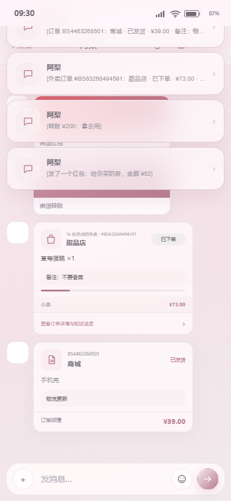

# BS 小手机 3.97 / Build108｜红队与检查官第三轮返修｜完整报告

日期：2026-11-12  
版本：`3.97 / Build108`  
CacheKey：`bsphone-v108-20261111-r1`  
源码目录：`C:\Users\lenovo\Documents\ChatGPT\各种的\_ghpages`  
代码提交：`0a49c9365d3ba5ee4328a9506c97794c83125361`  
源码 SHA-256：`EEF7186E58A3F38FBDA4DC1144B2759687E264AE3EE577F509DE11FF7243C43A`

## 1. 任务进程

本轮按红队和检查官的 3.96 / Build107 复检报告返修，不重写无关模块：

1. 修复多金额句子主金额被手续费、配送费、优惠、备注覆盖。
2. 修复未来/意愿/条件词跨分句误杀已完成动作。
3. 修复“不好意思/不用客气”等礼貌前缀被当成否定。
4. 支持口语“我给你下单了”进入订单卡解析。
5. 增加“叫外卖，合计金额”这类口语外卖解析。
6. 重新跑当前完整回归、微信历史分支、独立卡片上下文脚本。
7. 直接覆盖更新主应用 Release，不清理主应用数据；合成数据测试改用主机浏览器，不再反复安装 QA 包。
8. 重新生成 APK、ZIP、线上发布和证据清单。

主队自测结论：**PASS，待红队与检查官复检签收**。

## 2. 复检问题与返修结果

| 复检问题 | 返修结果 |
|---|---|
| 转账 200 元被手续费 2 元覆盖 | PASS，金额 200 |
| 红包 52 元被 8 元优惠券覆盖 | PASS，金额 52 |
| 红包 52 元被备注 100 覆盖 | PASS，金额 52 |
| 外卖 68 元被配送费 3 元覆盖 | PASS，金额 68 |
| 订单 39 元被运费 3 元覆盖 | PASS，金额 39 |
| 一会儿/晚点/下周/等我忙完/马上 | PASS，不生成卡片 |
| 未来词出现在独立备注分句 | PASS，不阻断已完成动作 |
| “不好意思，给你发红包” | PASS，红包 52 |
| “不用客气，给你发红包” | PASS，红包 52 |
| “我给你下单了，手机壳39元” | PASS，订单 39 |
| “我叫外卖，合计68元，其中配送费3元” | PASS，外卖 68 |
| ZIP 反斜杠/checksums 名称 | PASS，17 entries，反斜杠 0，name delta 0 |
| 证据清单行尾稳定性 | 增加 `.gitattributes` LF 规则，并登记 raw/normalized hash |

## 3. 代码修复摘要

### 3.1 主金额与辅助金额

`chatCardAmount()` 现在：

- 优先货币符号与“元/块”单位。
- 对“手续费、配送费、服务费、运费、优惠、折扣、优惠券、备注、订单号、编号、尾号、预计分钟”等辅助金额减去高权重。
- 采用分句窗口，避免“手机壳39元，运费3元”被整段上下文污染。
- 平局时保留先出现的主金额，不让后出现的从属金额覆盖。

### 3.2 分句动作绑定

`chatCardBlockedContext()` 现在：

- 先找到包含卡片动作的分句。
- 未来/条件/否定只检查动作分句，不扫描整句。
- “下次请我喝奶茶”“明天送到，不要香菜”作为独立备注，不阻断已完成的发送/下单。
- “一会儿、晚点、下周、等我忙完、马上”等未来词在动作分句内时阻断。
- “不好意思、不用客气”这类礼貌前缀不再被当作动作否定。

### 3.3 口语订单与外卖

订单入口接受“下单了”口语动作，不要求出现字面“订单”；外卖入口补充“我叫外卖/我叫了外卖”等已完成动作。

## 4. 逻辑证据

- `docs/testing/round143-card-context.json`：17 项卡片上下文矩阵 PASS
- `docs/testing/round143-full-regression-2026-11-11.log`：26/26 PASS
- `docs/testing/round143-wechat-branch-regression-2026-11-11.log`：10/10 PASS
- 独立 `_qa_round142_card_context_edge.cjs`：PASS
- 独立 `_independent_card_multi_amount_2026-11-11.cjs`：PASS
- 独立 `_independent_card_phrases_2026-11-11.cjs`：PASS

## 5. 截图证据



截图使用合成姓名、示例银行、示例订单和示例消息，不包含主应用真实会话。

## 6. 真机与安装策略

本轮采纳用户意见，不再反复安装独立 QA 包：

- 主应用 `com.xiaoshouji.app` 使用同包名、同签名、递增 versionCode 覆盖更新。
- 未清理主应用数据，未清空聊天、钱包或人设。
- QA 包未使用。
- 合成数据卡片测试在主机浏览器执行，主应用数据未被注入或读取。
- Release 真机验证：3.97 / 108、前台 `MainActivity`、APK hash 一致、FATAL/ANR/JS Error 0。

设备：OPPO PMK110 / Android 16。  
firstInstallTime：`2026-10-20 23:07:55`，保持不变。

## 7. 全量回归

结果：**26 / 26 PASS**

覆盖当前微信模块、历史分支、卡片正负例、并发输入状态、组件卡底图、主题、壁纸、外观、18 App 预览、37 内部页面、财务、持久化和全页亮暗回归。

微信历史分支：**10 / 10 PASS**。

## 8. Release 与 ZIP

- Release APK：`AF816A20A8A26D739E0F11BD9E23BB5F189665DE12638AAC68A954CF6A2AC601`
- Release APK 字节：588,982
- Release ZIP：`848C11AD251512BD6355381F9FDD756B055BDA1F73719F87EBE28D079D297E0B`
- ZIP entries：17
- checksum mismatch：0
- 反斜杠条目：0
- checksum key 与 ZIP 原始名称集合一致

产物：

- `C:\Users\lenovo\Documents\ChatGPT\各种的\_ghpages\BS小手机.apk`
- `C:\Users\lenovo\Documents\ChatGPT\各种的\_ghpages\BS小手机_3.97_Build108_release.zip`
- `C:\Users\lenovo\Documents\ChatGPT\各种的\_ghpages\_release_candidate_2026-11-11_Build108_pkg`

## 9. 线上发布

- Pages 部署：https://github.com/BLKST123/bsphone/actions/runs/43162948871
- 线上页面：https://blkst123.github.io/bsphone/?v=108-r1
- 线上版本：3.97 / Build108
- 线上 APK hash：`AF816A20A8A26D739E0F11BD9E23BB5F189665DE12638AAC68A954CF6A2AC601`
- 线上 APK 与本地 Release 一致
- 线上 `index.html` 与本地规范化文本一致
- 证据：`docs/testing/round143-online-publish.json`

## 10. 隐私与证据

- 公开仓库为干净树，旧私密仓库保持 private archive。
- 旧内容 API：404；旧 commit API：422。
- 当前公开树私密词表扫描：0 命中。
- 新增 `.gitattributes`，文本证据统一 LF。
- 证据清单登记 `sha256` 和 `normalizedSha256`，避免 CRLF/LF 口径歧义。

最终清单：

`docs/testing/round143-evidence-manifest.json`

## 11. 主队职位局限

1. 本轮没有重新安装独立 QA 包，合成数据卡片用例在主机浏览器执行；真机完成 Release 覆盖安装、版本、前台、APK hash 和 logcat 验收。这样避免反复触发 OPPO 侧载确认，但真机未再次执行合成数据 UI 点击套件。
2. 金额上下文采用保守规则，无明确主金额时仍会回退纯文本。
3. 通用订单卡仍是聊天快照，不写入完整网购订单数据库。
4. 语音/视频通话仍为视觉入口壳。
5. 本轮只签收微信卡片、并发状态、组件底图、发布与隐私链路，不把其它 App 全部 PRD 分支自动标为完成。

## 12. 最终签署

```text
主金额/辅助金额：PASS
未来/条件/意愿分句：PASS
礼貌句红包：PASS
口语下单：PASS
叫外卖合计金额：PASS
当前全量 26/26：PASS
微信历史 10/10：PASS
Release 覆盖更新且数据保留：PASS
ZIP 正斜杠与 checksums：PASS
线上 3.97 / 108：PASS
隐私公开树：PASS
主队自测结论：PASS，待红队/检查官复检
```
